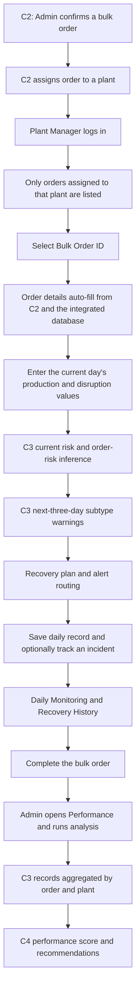
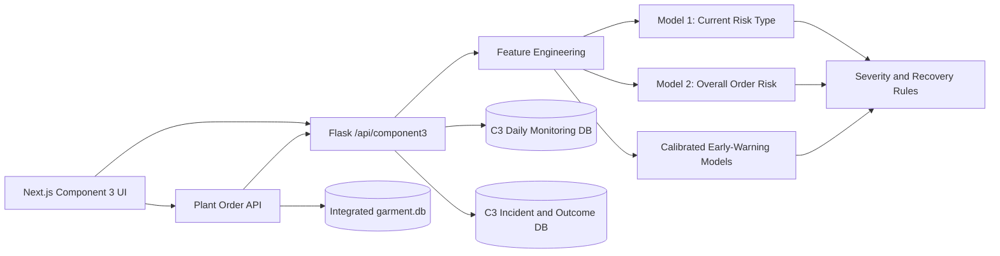
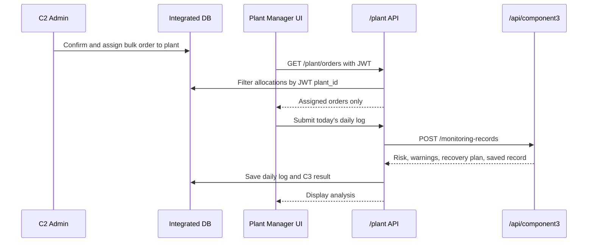

# Component 3 — Emergency Situation Detection and Management

> Research component of the FabricFlow Garment Production Management System

| Item | Details |
| --- | --- |
| Student | Alagiyawanna S.A.M.A.V.P |
| Student ID | IT22904614 |
| Research component | Component 3 — Emergency Situation Detection and Management |
| Repository | [IT22548146/R26-IT-002](https://github.com/IT22548146/R26-IT-002) |
| Development branch | `component3` |
| Backend API | `http://localhost:5001/api/component3` |
| Frontend | `http://localhost:3000` |
| Current model configuration | `COMPONENT3_MODEL_VERSION=v3` |
| Research status | Working academic prototype; saved ML artifacts are not production approved |

## Table of contents

- [1. Abstract](#1-abstract)
- [2. Research problem](#2-research-problem)
- [3. Limitations addressed](#3-limitations-addressed)
- [4. Aim, objectives, and research questions](#4-aim-objectives-and-research-questions)
- [5. Proposed solution and contribution](#5-proposed-solution-and-contribution)
- [6. Scope and requirements](#6-scope-and-requirements)
- [7. Integrated system workflow](#7-integrated-system-workflow)
- [8. Component 3 architecture](#8-component-3-architecture)
- [9. Technology stack](#9-technology-stack)
- [10. Dataset](#10-dataset)
- [11. Data preparation and feature engineering](#11-data-preparation-and-feature-engineering)
- [12. Machine-learning methodology](#12-machine-learning-methodology)
- [13. Model results](#13-model-results)
- [14. Recovery engine](#14-recovery-engine)
- [15. Runtime implementation](#15-runtime-implementation)
- [16. Component 2 → Component 3 integration](#16-component-2--component-3-integration)
- [17. Component 3 → Component 4 integration](#17-component-3--component-4-integration)
- [18. Persistence and database design](#18-persistence-and-database-design)
- [19. Security and plant-wise access control](#19-security-and-plant-wise-access-control)
- [20. User interfaces](#20-user-interfaces)
- [21. Component 3 API](#21-component-3-api)
- [22. Installation and configuration](#22-installation-and-configuration)
- [23. Running the application](#23-running-the-application)
- [24. Reproducing model training](#24-reproducing-model-training)
- [25. Testing](#25-testing)
- [26. End-to-end demonstration](#26-end-to-end-demonstration)
- [27. Results interpretation and validity](#27-results-interpretation-and-validity)
- [28. Limitations](#28-limitations)
- [29. Future work](#29-future-work)
- [30. Project structure and evidence](#30-project-structure-and-evidence)
- [31. Thesis-use guidance](#31-thesis-use-guidance)

## 1. Abstract

Component 3 is an emergency situation detection and management subsystem for
garment bulk-order production. It monitors the daily progress of orders
assigned by Component 2, detects current operational risks, estimates overall
order-delivery risk, predicts supported emergency subtypes within the next
three production days, and generates a deadline-aware recovery plan.

The component does more than return a prediction. It stores stable and
emergency production days, maintains order-wise monitoring history, supports
supervisor verification of actual outcomes, tracks recovery decisions and
their execution, and provides aggregated Component 3 production evidence to
Component 4 for post-completion performance analysis.

The implementation combines:

- supervised machine-learning classifiers for current and future risks;
- calibrated probabilities and target-specific warning thresholds;
- deterministic, explainable recovery-planning rules;
- role-based, plant-scoped APIs;
- SQLite persistence and audit history; and
- an integrated Next.js user interface for Plant Managers and Managers.

The evaluation is deliberately order-grouped. Complete bulk orders are held
out using Leave-One-Group-Out validation, preventing daily rows from the same
order from appearing in both training and validation. The saved artifacts are
research outputs and are not presented as production-approved models.

## 2. Research problem

Garment production is affected by daily variations such as worker shortages,
machine breakdowns, quality-limit violations, insufficient output, and
schedule pressure. A problem identified only at the end of an order leaves
little time for recovery and can cause missed buyer deadlines.

The research problem addressed by Component 3 is:

> How can daily garment-production observations be used to detect current
> emergencies, predict supported near-future operational risks, and recommend
> an executable recovery plan before a bulk order misses its buyer deadline?

The system must also maintain traceability. A predicted risk, a recovery
recommendation, the manager's chosen action, and the actual production outcome
must remain distinguishable and auditable.

## 3. Limitations addressed

The implementation is designed to address the following practical limitations
commonly found in manual or partially digitised production-monitoring
workflows:

1. **Reactive monitoring** — problems are reviewed after a large delay has
   already occurred.
2. **Fragmented data** — order planning, daily production logs, risk analysis,
   and post-production performance are kept in separate workflows.
3. **Manual order re-entry** — repeated manual entry can produce inconsistent
   order quantities, dates, plants, and style identifiers.
4. **Generic alerts** — a simple red/green alert does not identify the likely
   emergency type, confidence, severity, or responsible users.
5. **Prediction without action** — a risk score alone does not explain how many
   pieces per day must be recovered or which operational action is feasible.
6. **No outcome audit** — model detections can accidentally be reused as their
   own training labels when actual factory outcomes are not verified.
7. **Data leakage in evaluation** — random row splits can place daily records
   from the same bulk order in both training and test sets.
8. **No plant isolation** — a Plant Manager should not see or modify another
   plant's assigned orders, monitoring history, or recovery incidents.
9. **Weak downstream integration** — production risks are often omitted from
   final plant-performance analysis.

This section describes the implementation gap addressed by the project. A
thesis literature review should support claims about prior systems with
peer-reviewed or otherwise authoritative external citations.

## 4. Aim, objectives, and research questions

### 4.1 Aim

To design and implement an intelligent, integrated component that detects and
manages emergency situations during garment bulk-order production using daily
factory data.

### 4.2 Objectives

1. Collect order-specific daily production and disruption measurements.
2. Detect the current operational risk type using a multiclass classifier.
3. Estimate the overall High/Low order-delivery risk.
4. Predict supported emergency subtypes within the next three production days.
5. Generate an explainable, deadline-aware recovery plan.
6. Store daily records, recovery decisions, execution states, and outcomes.
7. Enforce plant-wise visibility using the authenticated Plant Manager account.
8. Aggregate completed-order Component 3 evidence for Component 4 analysis.
9. Evaluate models without leaking observations from the same bulk order.

### 4.3 Research questions

- **RQ1:** Can current daily production measurements classify the present
  operational risk type?
- **RQ2:** Can order progress and deadline features estimate overall order risk?
- **RQ3:** Can current and past-only order history predict specific emergency
  subtypes within the next three production days?
- **RQ4:** Can model outputs and declared factory limits be converted into an
  explainable recovery plan?
- **RQ5:** Can the solution operate as part of an end-to-end C2 → C3 → C4
  production-management workflow while preserving plant-level access control?

## 5. Proposed solution and contribution

Component 3 contributes the following integrated capabilities:

- current-day seven-class risk-type classification;
- binary overall order-risk classification;
- calibrated next-three-production-day subtype warning models;
- deterministic severity, alert-routing, and recovery decisions;
- plant-scoped automatic retrieval of Component 2 assigned orders;
- daily monitoring history with chronological and cumulative-output controls;
- supervisor-verified ground truth and automatic future-label construction;
- recovery approval, execution, outcome, and audit tracking;
- critical-risk dashboard/email notification support in the integrated plant
  logging workflow; and
- order/plant-level aggregation of Component 3 records for Component 4.

An important design decision is the separation of four concepts:

| Concept | Implementation |
| --- | --- |
| Current risk detection | Model 1 predicts the present production condition. |
| Delivery exposure | Model 2 and schedule calculations estimate overall order risk. |
| Future warning | Three calibrated models estimate specific risks over the next three production days. |
| Recovery management | A deterministic engine calculates feasible operational actions and tracks their outcomes. |

## 6. Scope and requirements

### 6.1 Functional requirements

- Show only bulk orders assigned to the authenticated Plant Manager's plant.
- Auto-fill order identity, buyer, plant, quantity, dates, daily commitment,
  and production-phase data from Component 2.
- Accept actual output, damage, machine breakdown, and worker-shortage values.
- Calculate cumulative production using saved order history.
- Validate dates, quantities, working-day order, and completion state.
- Analyse current risk and overall order risk.
- Produce supported next-three-day subtype warnings.
- Generate a recovery recommendation and alternatives.
- Save stable and emergency daily records.
- Store and manage recovery incidents.
- Verify actual outcomes without overwriting the audit trail.
- Expose order-wise Daily Monitoring and Recovery History pages.
- Aggregate completed-order logs and send them to Component 4.

### 6.2 Non-functional requirements

- **Security:** JWT-based role checks and server-side plant scope.
- **Auditability:** raw model decisions, business-rule overrides, verification
  history, and incident events remain available.
- **Explainability:** risk type, severity, progress, required daily rate, and
  recovery calculations are returned separately.
- **Data integrity:** duplicate days, inconsistent order identity, decreasing
  cumulative output, and invalid dates are rejected.
- **Maintainability:** feature construction, inference, monitoring, recovery,
  tracking, and validation are separated into modules.
- **Portability:** local Flask, Next.js, SQLite, and saved model artifacts allow
  the research prototype to run on another development machine.
- **Reproducibility:** training scripts, metadata, model-comparison files, and
  machine-readable evaluation reports are retained in the repository.

## 7. Integrated system workflow



## 8. Component 3 architecture



### 8.1 Layer responsibilities

| Layer | Responsibility |
| --- | --- |
| Presentation | Monitoring, Daily Monitoring History, and Recovery History pages. |
| Portal integration | Retrieves plant-assigned C2 orders and submits integrated daily logs. |
| API | Validates requests, enforces roles, runs inference, and returns canonical responses. |
| Feature engineering | Recreates the exact model feature order from raw production fields. |
| ML inference | Loads `.pkl`/`.joblib` artifacts and returns classes/probabilities. |
| Decision support | Applies severity, alert-routing, schedule, and recovery rules. |
| Persistence | Stores daily observations, verified outcomes, incidents, actions, and events. |
| Downstream analytics | Aggregates saved logs into the Component 4 payload. |

## 9. Technology stack

| Area | Technology |
| --- | --- |
| Backend | Python, Flask 3.1.3, Flask-CORS |
| ML/data | scikit-learn 1.8.0, XGBoost 3.2.0, pandas 3.0.2, NumPy 2.4.4 |
| Artifact persistence | joblib 1.5.3 (`.pkl` and `.joblib`) |
| Main frontend | Next.js 16.2.10, React 19.2.4, TypeScript 5 |
| Integrated database | SQLite (`garment.db`) |
| Component 3 monitoring database | SQLite (`instance/component3_tracking.db`) |
| Authentication | JWT and Flask role middleware |
| Model evaluation | Leave-One-Group-Out, Accuracy, Macro-F1, Weighted-F1, ROC-AUC, Brier score, log-loss, ECE |
| Testing | pytest 8.3.4; frontend ESLint and TypeScript checks |

The current local virtual environment uses Python 3.11. The stored model
metadata records the training environment used for the artifacts.

## 10. Dataset

### 10.1 Dataset inventory

| File | Purpose | Evidence boundary |
| --- | --- | --- |
| `data/component3_final_preprocessed_dataset.xlsx` | Original historical daily order records | 598 real rows, 11 bulk orders, 11 styles |
| `data/component3_training_augmented.xlsx` | Model 1 and earlier Model 2 training source | Controlled augmentation is used in training folds only |
| `data/component3_training_balanced_research_v2.xlsx` | Deadline-aware Model 2 v3 training source | Low-risk augmentation is used in training folds only |

The original historical workbook contains 598 usable daily observations from
11 independent bulk orders. The evidence audit reports:

- 11 worksheets/orders;
- 11 styles;
- 0 duplicate order-date rows;
- 0 cumulative-output mismatch rows; and
- 0 rows whose cumulative production exceeds the full order quantity.

### 10.2 Current risk-type class distribution

| Risk type | Real rows | Orders containing the class |
| --- | ---: | ---: |
| No Issue | 193 | 11 |
| Minor Delay | 4 | 1 |
| Working Hours Issue | 128 | 10 |
| Worker Issue | 188 | 11 |
| Commitment Too Low | 37 | 9 |
| Machine Breakdown Issue | 44 | 11 |
| Quality Issue | 4 | 4 |

The class distribution is imbalanced. In particular, Minor Delay and Quality
Issue contain only four real rows each. Their per-class results therefore
cannot be treated as strong independent production evidence.

### 10.3 Augmentation policy

For `component3_training_augmented.xlsx`, metadata identifies:

- 598 real rows from 11 real orders;
- 479 controlled augmented training rows from 12 augmented orders; and
- 885 pre-existing generated rows excluded by the selected training policy.

For Model 2 v3, metadata identifies:

- 598 real rows from 11 real orders;
- only 1 independent real Low Risk order; and
- 725 controlled augmented training rows from 20 augmented orders.

Augmented rows are never used as validation evidence. They are added only to
the training side of each grouped fold.

### 10.4 Early-warning dataset

The early-warning experiment rebuilds labels from the original 598 historical
records and uses no augmented or generated rows. A source day is eligible only
when:

- the current day is stable;
- a complete next-three-production-day window exists; and
- the future window remains inside the same bulk order.

This produces 174 eligible stable source rows across 11 orders.

| Early-warning target | Positive rows | Negative rows | Positive orders | Negative orders |
| --- | ---: | ---: | ---: | ---: |
| Machine breakdown within 3 days | 47 | 127 | 11 | 11 |
| Quality-limit issue within 3 days | 134 | 40 | 11 | 11 |
| Output/schedule risk within 3 days | 25 | 149 | 10 | 11 |

The current dataset does **not** support:

- a general `Emergency Within 3 Days` model, because all 174 eligible rows are
  positive and no negative class exists; or
- a worker-shortage future-warning model, because only 9 negative rows from 1
  negative order are available.

Worker shortage is still handled by the current-day detector and recovery
engine.

## 11. Data preparation and feature engineering

### 11.1 Core input fields

Each prediction uses order identity, schedule, production, quality, and
disruption fields, including:

- bulk order, style, buyer, assigned plant, and plant location;
- full order quantity and cumulative completed quantity;
- approved date, production date, and buyer-required date;
- total, cutting, sewing, and current working-day numbers;
- daily commitment and actual daily output;
- daily damage and maximum allowed damage;
- machine-breakdown count; and
- worker-shortage count.

### 11.2 Engineered feature groups

| Group | Examples |
| --- | --- |
| Output performance | `Output_Gap`, `Gap_Pct`, `Output_vs_Commit_Ratio` |
| Quality | `Damage_Ratio`, `Is_Quality_Issue` |
| Disruption | `Is_Machine_Breakdown`, `Is_Worker_Shortage` |
| Order progress | `Remaining_Qty`, `Day_Progress_Pct`, `Days_Remaining` |
| Schedule demand | `Required_Daily_Rate`, `Commitment_Gap_Rate` |
| Process stage | `Is_Cutting_Phase`, `Is_Sewing_Phase` |
| Deadline-aware Model 2 v3 | available working days, deadline-required daily rate, commitment slack, completion state |
| Early-warning history | previous output, trailing three-day mean/variation, recent incident counts, days since last emergency |

Model 1 uses 24 current/order-progress features. Model 2 v3 extends the feature
set to 30 with deadline-aware features. Early-warning models use 30
current-and-past-only features.

### 11.3 Leakage controls

The following are not used as predictive inputs where they would reveal the
target or future:

- `Bulk_Order_ID`, style, buyer, and plant identity;
- production and completion dates as direct identity/time shortcuts;
- risk status, risk type, and system recommendation;
- future warning labels and first future emergency information;
- supervisor verification fields; and
- future production observations.

Preprocessing is fitted inside each training fold. A held-out order is not used
to fit its own transformation, model, calibration mapping, or warning
threshold.

## 12. Machine-learning methodology

### 12.1 Why the split is not random 80/20

Daily records from the same bulk order are correlated. A random row-level
80/20 split could place different days from the same order in both training and
test sets, producing optimistic results.

The project uses **Leave-One-Group-Out (LOGO)** validation with
`Bulk_Order_ID` as the group:

1. hold out one complete real bulk order;
2. fit preprocessing and the candidate model on the remaining real orders;
3. add approved augmented rows only to the training fold;
4. predict every row of the unseen held-out order once;
5. repeat for all 11 orders; and
6. combine all out-of-fold predictions to calculate metrics.

### 12.2 Model 1 — current risk type

Model 1 is a seven-class classifier. The candidates are:

- Dummy most-frequent baseline;
- class-balanced Logistic Regression;
- class-balanced Random Forest; and
- class-balanced Extra Trees.

The selected model is **Random Forest**.

### 12.3 Model 2 — overall order risk

Model 2 v3 predicts `Low Risk` or `High Risk`. It extends the original feature
set with deadline-aware schedule features. The candidates are:

- Dummy baseline;
- Logistic Regression;
- Random Forest; and
- Gradient Boosting.

The selected model is **Random Forest**. The application loads
`c3_model2_order_risk_v3.pkl` by default.

### 12.4 Early-warning models

Separate binary classifiers are trained for:

- machine breakdown within the next three production days;
- quality-limit issue within the next three production days; and
- output/schedule risk within the next three production days.

Candidates include Dummy prior, class-balanced Logistic Regression,
class-balanced Random Forest, and XGBoost. Model selection prioritises:

1. Macro-F1;
2. positive-class F1; and
3. Accuracy.

Macro-F1 is prioritised because Accuracy can reward a classifier that ignores
the minority class.

### 12.5 Probability calibration

The selected early-warning model for each target is calibrated using nested
order-grouped validation and a sigmoid mapping. Each target receives its own
decision threshold, selected from held-out calibrated probabilities rather
than assuming a universal 0.50 threshold.

The saved early-warning artifacts contain:

- the fitted preprocessing/model pipeline;
- the grouped sigmoid calibrator;
- exact feature order;
- target and horizon;
- grouped evaluation metrics;
- probability-quality metrics; and
- the target-specific threshold.

### 12.6 Group-safe hyperparameter optimization and ensemble comparison

The follow-up optimization study directly addresses parameter-selection and
ensemble-model review. It uses a nested grouped design:

- outer validation: `LeaveOneGroupOut` by `Bulk_Order_ID`;
- inner parameter search: `GridSearchCV` with three-fold `GroupKFold`;
- primary objective: unseen-order Macro-F1;
- tuned estimators: class-balanced Logistic Regression and Random Forest; and
- explicit ensemble: probability-based soft voting between the two tuned
  estimators, with grouped optimization of their voting weights.

An outer test order is excluded from parameter selection, ensemble-weight
selection, and model fitting. This prevents an order's daily rows from
appearing in both training and evaluation. The study is evidence-only: it does
not automatically replace the calibrated artifacts used by the application.

### 12.7 Parameters, search spaces, and rationale

#### Operational input parameters

The models receive measurable production and deadline evidence rather than
buyer or plant identity as predictive inputs.

| Feature group | Examples | Reason for inclusion |
| --- | --- | --- |
| Output plan and actuals | Daily commitment, actual output, output gap, gap percentage | Measures daily production under-performance |
| Operational disruption | Machine breakdown count, worker-shortage count | Represents direct emergency triggers |
| Quality | Daily damage, allowed damage, damage ratio | Detects quality-limit exposure |
| Order progress | Cumulative completed quantity, remaining quantity, working day | Measures completion position |
| Deadline exposure | Days remaining, required daily rate, commitment slack | Measures whether remaining work is feasible before the buyer deadline |
| Production phase | Cutting and sewing phase flags | Preserves process-stage context |
| Historical trend | Previous output, trailing-three-day output/gap/emergency counts | Supports future-warning predictions from recent behaviour |

Order identity, buyer name, plant name, future outcomes, and completion-date
labels are excluded from model inputs to reduce identity memorisation and
target leakage.

#### Active current-risk and order-risk model parameters

| Model | Selected parameters | Rationale |
| --- | --- | --- |
| Current risk type — Random Forest | `n_estimators=300`, `max_depth=12`, `min_samples_leaf=3`, `class_weight=balanced`, `random_state=42` | Stable nonlinear multi-class prediction while constraining small-leaf overfitting and compensating for class imbalance |
| Overall order risk v3 — Random Forest | `n_estimators=300`, `max_depth=10`, `min_samples_leaf=5`, `class_weight=balanced`, `random_state=42` | Conservative tree complexity for deadline-aware binary risk prediction |

#### Early-warning optimization search space

| Model | Searched hyperparameter | Values evaluated | Why it matters |
| --- | --- | --- | --- |
| Logistic Regression | `C` | `0.05`, `0.2`, `1.0`, `5.0` | Controls regularization; smaller values reduce overfitting while larger values allow a more flexible boundary |
| Random Forest | `n_estimators` | `200`, `400` | Compares ensemble stability against training cost |
| Random Forest | `max_depth` | `None`, `8` | Compares unrestricted and constrained tree complexity |
| Random Forest | `min_samples_leaf` | `1`, `3` | Controls whether decisions can depend on very small leaves |
| Random Forest | `max_features` | `sqrt` | Increases diversity among trees |
| Soft Voting | Logistic:Forest weights | `1:1`, `2:1`, `1:2` | Tests equal weighting and greater emphasis on either the linear or nonlinear model |

The Logistic Regression pipeline also uses `StandardScaler`,
`class_weight=balanced`, `max_iter=5000`, and `random_state=42`. The Random
Forest uses `class_weight=balanced_subsample` and `random_state=42`. Scaling is
required for stable Logistic Regression optimization; balanced weights reduce
majority-class dominance; and the fixed seed makes the experiment
reproducible.

#### Selected optimized settings

| Target | Selected research candidate | Selected settings |
| --- | --- | --- |
| Machine breakdown within three days | Soft Voting | Logistic `C=5.0`; Random Forest: 400 trees, unrestricted depth, leaf size 1, `sqrt` features; voting weights `2:1` |
| Quality-limit issue within three days | Logistic Regression | `C=0.05`, providing stronger regularization |
| Output/schedule risk within three days | Logistic Regression | `C=1.0`, providing balanced regularization |

#### Validation and threshold parameters

| Setting | Value | Justification |
| --- | --- | --- |
| Outer validation | `LeaveOneGroupOut` | Evaluates every order while keeping it absent from its own training and tuning |
| Inner search | Three-fold `GroupKFold` + `GridSearchCV` | Selects parameters only from outer-training orders |
| Grouping key | `Bulk_Order_ID` | Prevents daily rows from the same order entering both train and test sets |
| Primary metric | Macro-F1 | Gives both emergency and non-emergency classes equal importance |
| Reproducibility | `random_state=42` | Produces repeatable experiments |

The calibrated early-warning decision thresholds are target-specific:

| Target | Decision threshold |
| --- | ---: |
| Machine breakdown | 32.385% |
| Quality-limit issue | 72.629% |
| Output/schedule risk | 19.515% |

These thresholds were selected from grouped out-of-fold calibrated
probabilities to maximize Macro-F1; a universal 50% threshold was not assumed.

## 13. Model results

### 13.1 Model 1 — current risk type

| Candidate | Accuracy | Macro-F1 | Weighted-F1 | Selected |
| --- | ---: | ---: | ---: | --- |
| Dummy most frequent | 32.27% | 6.97% | 15.75% | No |
| Logistic Regression | 76.42% | 80.44% | 76.94% | No |
| Random Forest | **81.77%** | **90.08%** | **81.93%** | **Yes** |
| Extra Trees | 80.10% | 89.24% | 80.17% | No |

The main remaining confusion is between `Working Hours Issue` and
`Worker Issue`. Metrics for very small classes must be interpreted cautiously.

### 13.2 Model 2 v3 — overall order risk

| Candidate | Accuracy | Macro-F1 | Weighted-F1 | ROC-AUC | Selected |
| --- | ---: | ---: | ---: | ---: | --- |
| Dummy baseline | 5.85% | 5.53% | 0.65% | 50.00% | No |
| Logistic Regression | 99.67% | 98.52% | 99.67% | 100.00% | No |
| Random Forest | **99.83%** | **99.25%** | **99.83%** | **99.99%** | **Yes** |
| Gradient Boosting | 99.83% | 99.25% | 99.83% | 99.82% | No |

The selected confusion matrix is `[[35, 0], [1, 562]]`, corresponding to one
false Low Risk row. However, the 35 Low Risk daily rows belong to only one
independent real Low Risk order. The high score is therefore research evidence,
not proof of production generalisation.

### 13.3 Calibrated next-three-day warnings

| Target | Selected model | Accuracy | Macro-F1 | Positive-class F1 | Threshold |
| --- | --- | ---: | ---: | ---: | ---: |
| Machine breakdown | Random Forest | **86.21%** | **84.05%** | **78.18%** | 32.385% |
| Quality-limit issue | Logistic Regression | **66.67%** | **51.18%** | **78.68%** | 72.629% |
| Output/schedule risk | Logistic Regression | **79.31%** | **63.75%** | **40.00%** | 19.515% |

Calibration improved Brier score, log-loss, and expected calibration error for
all three selected targets. These are model-selection results from the
available 11 orders, not a locked external production test.

### 13.4 Nested tuning and soft-voting results

| Target | Nested winner | Accuracy | Macro-F1 | Positive-class F1 |
| --- | --- | ---: | ---: | ---: |
| Machine breakdown | Soft Voting: Logistic Regression + Random Forest | **86.21%** | **84.20%** | **78.57%** |
| Quality-limit issue | Tuned Logistic Regression | **66.09%** | **59.76%** | **75.72%** |
| Output/schedule risk | Tuned Logistic Regression | **73.56%** | **61.99%** | **41.03%** |

The full-data grouped search selected the following reproducible settings:

- machine target: Logistic Regression `C=5.0`, Random Forest with 400 trees,
  unrestricted depth and minimum leaf size 1, then soft-voting weights `2:1`;
- quality target: Logistic Regression `C=0.05`; and
- output/schedule target: Logistic Regression `C=1.0`.

The ensemble produced a small nested improvement for machine breakdown and
the tuned Logistic Regression improved the quality target. The tuned
output/schedule result did not exceed the existing calibrated evidence, so the
active output model remains unchanged. No active artifact is promoted solely
because it is more complex; it must improve comparable grouped evidence and
pass integration tests first.

Detailed reproducible evidence is stored in
`reports/component3_model_optimization/`.

### 13.5 Saved model artifacts

```text
models/c3_model1_risk_type_v2.pkl
models/c3_model2_order_risk_v3.pkl
models/c3_early_warning_machine_breakdown_v2.joblib
models/c3_early_warning_quality_limit_v2.joblib
models/c3_early_warning_output_schedule_risk_v2.joblib
```

## 14. Recovery engine

The recovery engine is deterministic business logic, not a trained ML model.
It converts the validated order state, detected risk, remaining quantity,
available working days, and optional factory limits into executable options.

Possible options include:

- continue the current plan;
- add overtime;
- reassign additional workers;
- repair a machine;
- activate backup machines;
- use backup-line capacity;
- combine multiple recovery resources; or
- escalate for plant reallocation/manual intervention.

The engine returns:

- remaining quantity;
- available working days;
- required daily rate;
- current sustainable daily capacity;
- daily recovery gap;
- feasible and infeasible options;
- a recommended option;
- expected completion date; and
- deadline margin.

### 14.1 Historical recovery validation

| Evaluation | Cases | Result |
| --- | ---: | --- |
| Current output as next-day baseline | 398 | MAE 46.312; RMSE 59.800; WAPE 13.631% |
| Recommended-capacity observational comparison | 276 | MAE 43.806; RMSE 61.367; WAPE 12.539% |
| Completion-date forecast | 280 | MAE 0.218 calendar days; 97.1% within 3 days |
| Deadline feasibility | 405 | 69.1% accuracy, but only the met-deadline actual class exists |

The recovery comparison is observational. The historical workbook contains
recommendations and later outputs but does not record which recovery action
was actually applied or its resource dose. It must not be described as causal
proof that the recommendation improved output.

## 15. Runtime implementation

### 15.1 Main prediction sequence

1. Validate all required order, date, schedule, output, and disruption fields.
2. Build Model 1 features using `component3_features.py`.
3. Load the configured risk-type artifact and predict the current class and
   confidence.
4. Build deadline-aware Model 2 v3 features using
   `component3_order_risk_features.py`.
5. Predict High/Low order risk and probability.
6. Calculate deterministic severity, alert targets, schedule exposure, and
   completion-safe overrides.
7. Retrieve only prior same-order monitoring history.
8. Run the three calibrated early-warning artifacts.
9. Build the deterministic recovery plan.
10. Return a structured response and, for save endpoints, persist the server-
    generated canonical input and analysis.

### 15.2 Main response sections

```text
order_summary
daily_production
risk_detection
early_warning
alert_system
scheduling
order_progress
production_summary
action
planning_output
recovery_plan
```

Raw model outputs are retained for research audit even when a completion-safe
business rule suppresses a non-actionable final-day alert.

### 15.3 Key implementation files

| File | Responsibility |
| --- | --- |
| `components/component3.py` | API routes, validation, model loading, response assembly |
| `components/component3_features.py` | Model 1 feature engineering |
| `components/component3_order_risk_features.py` | Model 2 v3 deadline-aware features |
| `components/component3_early_warning_data.py` | Future-label creation and readiness audit |
| `components/component3_early_warning_training.py` | Grouped comparison and calibration |
| `components/component3_early_warning_inference.py` | Runtime history features and warning inference |
| `components/component3_recovery.py` | Deterministic recovery planning |
| `components/component3_monitoring.py` | Daily records, verification, labels, readiness |
| `components/component3_tracking.py` | Incident workflow, outcomes, and audit events |
| `routes/plant.py` | C2-assigned order retrieval and integrated daily logging |
| `routes/admin.py` | C3 aggregation and Component 4 analysis trigger |

## 16. Component 2 → Component 3 integration

Component 2 confirms a bulk order and assigns it to a production plant. The
authenticated Plant Manager accesses `GET /plant/orders`. The backend filters
allocations using `g.plant_id`, so the dropdown contains only orders assigned
to that manager's plant.

Selecting an order supplies Component 3 with authoritative integrated values:

- bulk order ID and style number;
- buyer name;
- allocated plant and location;
- allocated/full quantity;
- approved date and buyer-required date;
- calculated plant daily commitment and capacity;
- total production, cutting, and sewing days; and
- order status and monitoring eligibility.

The Plant Manager enters only the new daily factory measurements. The
integrated log endpoint builds the canonical C3 payload, calls
`POST /api/component3/monitoring-records` internally, and saves the returned C3
analysis with the main production log.



## 17. Component 3 → Component 4 integration

Component 4 runs after an order is `Completed` or `Shipped` and has saved daily
production logs. The Admin Performance analysis aggregates Component 3 data
for the selected order and plant.

The integration calculates:

- number of logged production days;
- average daily output;
- total output and damage rate;
- number of machine-breakdown days;
- number of worker-shortage days;
- number of C3 risk days;
- number of Critical risk days; and
- number of recovery-required days.

The generated Component 4 payload includes
`risk_count_from_component3`, `machine_breakdown_days`,
`worker_shortage_days`, and `damage_rate`, together with order and plant
capacity fields. The C4 result is saved on the latest daily log so Performance
history remains available.


## 18. Persistence and database design

### 18.1 Integrated database

`garment.db` stores system-wide operational data, including:

- `bulk_orders`;
- `order_plant_allocations`;
- plants and users;
- `daily_logs` containing the integrated C3 JSON result; and
- stored Component 4 output on the latest relevant log.

### 18.2 Component 3 monitoring database

The default path is:

```text
instance/component3_tracking.db
```

It can be overridden with `COMPONENT3_TRACKING_DB`.

The database contains:

| Table | Purpose |
| --- | --- |
| `component3_daily_monitoring` | Canonical daily inputs, C3 analysis, labels, and verification status |
| `component3_monitoring_verifications` | Append-only outcome-verification audit records |
| `component3_incidents` | Saved recovery incident and selected decision |
| `component3_outcomes` | Actual production results and recovery effectiveness |
| `component3_incident_events` | Incident workflow audit timeline |

Important integrity rules include:

- one daily record per order/date and order/working-day number;
- one incident per order/production date;
- stable order identity and schedule across a monitoring sequence;
- non-decreasing cumulative output;
- no cumulative quantity above the full order quantity; and
- chronological future labels based on verified exact next-day records.

Local database files contain user-entered runtime data and should be backed up
before cleanup or transfer. They should not be committed to Git.

## 19. Security and plant-wise access control

### 19.1 Role access

| Role | Component 3 access |
| --- | --- |
| Plant Manager | Assigned orders, Emergency Monitoring, Daily Monitoring, Recovery History for the assigned plant |
| Manager | Cross-plant operational Component 3 pages according to manager permissions |
| Admin | Component 4 Performance workflow; direct C3 navigation is intentionally hidden in the current UI |
| Buyer | No Component 3 navigation |

### 19.2 Server-side plant scope

For a Plant Manager, the API derives the plant from the authenticated JWT
context (`g.plant_id`). It does not trust a browser-supplied plant query
parameter. Order, monitoring-record, and incident access is checked against
that plant before data is returned or changed.

### 19.3 Additional controls

- role middleware protects operational save/history endpoints;
- payload types, numeric ranges, and date relationships are validated;
- future production dates are rejected by the integrated plant log;
- model predictions are regenerated on the server before persistence;
- duplicate records produce conflict responses instead of silent overwrite;
- CORS origins are configured by environment; and
- `.env`, passwords, API keys, databases, and local caches must remain outside
  version control.

## 20. User interfaces

### 20.1 Emergency Monitoring

Path: `/component3/monitoring`

Functions:

- select a plant-assigned bulk order;
- auto-fill C2 order data;
- enter today's actual production and disruption values;
- analyse current risk, order exposure, early warnings, and recovery options;
- save the daily monitoring record; and
- save and track a recovery incident when necessary.

### 20.2 Daily Monitoring

Path: `/component3/monitoring-history`

Functions:

- list plant-scoped saved monitoring records;
- filter by order, risk, label, and verification status;
- view automatic three-day future labels;
- verify or correct actual outcomes while retaining audit history;
- inspect live grouped-training readiness; and
- export verified, leakage-audited training data when eligible records exist.

### 20.3 Recovery History

Path: `/component3/recovery-history`

Functions:

- list plant-scoped recovery incidents;
- review the saved analysis and recommended alternatives;
- approve a recovery decision;
- start and complete the action;
- record actual production outcomes; and
- review effectiveness and the audit timeline.

## 21. Component 3 API

Base URL:

```text
http://localhost:5001/api/component3
```

### 21.1 Operational endpoints

| Method | Endpoint | Purpose | Main role requirement |
| --- | --- | --- | --- |
| GET | `/health` | Component and artifact status | Public health check |
| POST | `/predict` | Run analysis without saving | Prediction endpoint |
| POST | `/monitoring-records` | Run and save one daily record | Manager / PlantManager |
| GET | `/monitoring-records` | List monitoring records with filters | Manager / PlantManager |
| GET | `/orders/{id}/monitoring-records` | Get one order's monitoring history | Manager / PlantManager |
| GET | `/orders/{id}/cumulative-context` | Retrieve the prior saved day for cumulative calculation | Manager / PlantManager |
| GET | `/orders/{id}/next-entry-context` | Get saved setup and the next chronological day | Manager / PlantManager |
| GET | `/monitoring-records/{record_id}` | Get one canonical record | Manager / PlantManager |
| PUT | `/monitoring-records/{record_id}/verification` | Verify/correct actual outcome | Manager / PlantManager |
| GET | `/monitoring-readiness` | Show live verified-label readiness | Manager / PlantManager |

### 21.2 Recovery tracking endpoints

| Method | Endpoint | Purpose |
| --- | --- | --- |
| POST | `/incidents` | Create a recovery incident from a canonical analysis |
| GET | `/incidents` | List plant-scoped incidents |
| GET | `/orders/{id}/incidents` | Get recovery history for one order |
| GET | `/incidents/{incident_id}` | Get analysis, decision, outcomes, and events |
| POST | `/incidents/{incident_id}/decision` | Approve a calculated recovery option |
| PATCH | `/incidents/{incident_id}/status` | Start or complete the action |
| POST | `/incidents/{incident_id}/outcomes` | Store actual output and effectiveness |

### 21.3 Research-data endpoints

| Method | Endpoint | Purpose |
| --- | --- | --- |
| GET | `/historical-import/preview` | Audit retrospective sources without changing the DB |
| POST | `/historical-import` | Import one explicitly confirmed retrospective order |
| GET | `/early-warning-validation` | Compare stored warnings with verified future outcomes |
| GET | `/training-dataset-audit` | Return leakage and class-balance audit |
| GET | `/training-dataset?format=csv` | Export verified Ready rows as CSV |
| GET | `/training-dataset?format=xlsx` | Export verified Ready rows as Excel |

Historical import is marked as training-data reuse and is never reported as
new independent validation.

### 21.4 Minimal prediction request example

```json
{
  "bulk_order_id": "11",
  "style_id": "ART-001",
  "buyer_name": "Example Buyer",
  "allocated_bulk_plant": "Dinusha Embroidery",
  "plant_location": "Weliweriya",
  "full_order_qty": 1500,
  "bulk_order_approved_date": "2026-08-20",
  "buyer_required_date": "2026-09-22",
  "total_working_days": 24,
  "cutting_days": 9,
  "sewing_days": 15,
  "daily_commitment": 250,
  "production_date": "2026-08-20",
  "working_day_no": 1,
  "plant_daily_output": 230,
  "daily_damage_qty": 2,
  "max_daily_damage_qty": 5,
  "machine_breakdown_count": 0,
  "worker_shortage_count": 1,
  "cumulative_completed_qty": 230
}
```

Example command:

```bash
curl -X POST http://localhost:5001/api/component3/predict \
  -H 'Content-Type: application/json' \
  --data @component3-request.json
```

## 22. Installation and configuration

### 22.1 Prerequisites

- Python 3.11 recommended for the current portable environment;
- Node.js 20+;
- npm 10+; and
- Git.

### 22.2 Clone the repository

```bash
git clone https://github.com/IT22548146/R26-IT-002.git
cd R26-IT-002
git checkout component3
```

Repository visibility depends on the GitHub account's access permissions.

### 22.3 Backend environment

```bash
python3 -m venv .venv
source .venv/bin/activate
python -m pip install --upgrade pip
python -m pip install -r requirements.txt
```

### 22.4 Environment file

```bash
cp .env.example .env
```

Minimum relevant values:

```dotenv
HOST=0.0.0.0
PORT=5001
FLASK_DEBUG=false
SECRET_KEY=replace-with-a-long-random-secret
CORS_ORIGINS=http://localhost:3000,http://127.0.0.1:3000
DATABASE_PATH=garment.db
COMPONENT3_MODEL_VERSION=v3

# Optional; default is instance/component3_tracking.db
COMPONENT3_TRACKING_DB=instance/component3_tracking.db
```

Frontend configuration in `frontends/.env.local` may contain:

```dotenv
NEXT_PUBLIC_API_URL=http://localhost:5001
NEXT_PUBLIC_COMPONENT3_API_URL=http://localhost:5001/api/component3
```

Do not place real passwords, API keys, or SMTP/IMAP credentials in this README
or commit them to Git. Rotate any credential that has previously been exposed.

### 22.5 Initialise the integrated database

On a new machine:

```bash
source .venv/bin/activate
python -m database.seed
```

Back up an existing `garment.db` and `instance/component3_tracking.db` before
reseeding or replacing databases.

## 23. Running the application

### Terminal 1 — Flask backend

```bash
cd "/path/to/Garment_model_backend_latest"
source .venv/bin/activate
python main.py
```

Verify:

```bash
curl http://localhost:5001/health
curl http://localhost:5001/api/component3/health
```

### Terminal 2 — Next.js frontend

```bash
cd "/path/to/Garment_model_backend_latest/frontends"
npm install
npm run dev
```

Open:

```text
http://localhost:3000
```

## 24. Reproducing model training

Training should be run from the project root with the backend environment
activated.

### 24.1 Model 1 and version-2 experiment

```bash
python train_component3_v2.py
```

Inputs and outputs:

```text
Input:   data/component3_training_augmented.xlsx
Models:  models/c3_model1_risk_type_v2.pkl
         models/c3_model2_order_risk_v2.pkl
Report:  reports/component3_v2/evaluation.json
```

### 24.2 Overall order-risk Model 2 v3

```bash
python train_component3_model2_v3.py
```

Inputs and outputs:

```text
Input:     data/component3_training_balanced_research_v2.xlsx
Model:     models/c3_model2_order_risk_v3.pkl
Metadata:  models/c3_model2_metadata_v3.json
Report:    reports/component3_model2_v3/evaluation.json
```

### 24.3 Calibrated early-warning models

```bash
python train_component3_early_warning.py
```

Inputs and outputs:

```text
Input:   data/component3_final_preprocessed_dataset.xlsx
Models:  models/c3_early_warning_*_v2.joblib
Report:  reports/component3_early_warning_step5b_calibrated/evaluation.json
CSV:     reports/component3_early_warning_step5b_calibrated/model_comparison.csv
```

### 24.4 Generate the PDF evidence report

```bash
python scripts/generate_component3_ml_report.py
```

Output:

```text
reports/Component3_Dataset_and_ML_Results_Report.pdf
```

## 25. Testing

There are 13 dedicated Component 3 backend test modules covering:

- feature engineering;
- v2 and Model 2 v3 training behaviour;
- early-warning data, training, inference, and validation;
- deterministic recovery rules;
- monitoring records and verified labels;
- incident workflow and outcomes;
- historical import and validation; and
- leakage-safe training export.

Run all Component 3 tests:

```bash
source .venv/bin/activate
python -m pip install -e ".[dev]"
python -m pytest -q tests/test_component3*.py
```

Current repository verification on 2026-10-09: **113 Component 3 tests
passed**. One non-blocking environment warning was emitted by the system
Anaconda environment because its `numexpr` package was older than the version
requested by pandas; no test failed.

Run important focused tests:

```bash
python -m pytest -q tests/test_component3_v2_api.py
python -m pytest -q tests/test_component3_model2_v3.py
python -m pytest -q tests/test_component3_early_warning_training.py
python -m pytest -q tests/test_component3_monitoring_api.py
python -m pytest -q tests/test_component3_tracking_api.py
python -m pytest -q tests/test_component3_recovery.py
```

Frontend checks:

```bash
cd frontends
npm run lint
npx tsc --noEmit
```

## 26. End-to-end demonstration

### 26.1 C2 → C3 daily monitoring

1. Log in as Admin and create/confirm a bulk order.
2. Assign the order to a plant.
3. Log in as that plant's Plant Manager.
4. Approve the assignment if required by the current order state.
5. Open **Emergency Monitoring**.
6. Select the Bulk Order ID from the assigned-order dropdown.
7. Confirm that buyer, plant, quantity, dates, commitment, and schedule auto-fill.
8. Enter today's output, damage, machine breakdown, and worker shortage values.
9. Select **Analyse risk & build recovery plan**.
10. Review current risk, delivery outlook, future warnings, and recovery plan.
11. Select **Save daily record**.
12. If recovery is required, save and manage the incident through
    **Recovery History**.
13. Repeat for the next chronological production day.

### 26.2 C3 → C4 performance analysis

1. Ensure the test order has saved C3/daily production logs.
2. Complete the order.
3. Log in as Admin and open **Performance**.
4. Select the completed order and run analysis.
5. Confirm that C3 risk counts, breakdown days, shortage days, output, and
   damage are aggregated.
6. Confirm that the Component 4 score and recommendations appear and are saved.

## 27. Results interpretation and validity

### 27.1 What the results demonstrate

- The selected models outperform their non-predictive baselines on the
  available order-grouped evaluation.
- The current-day detector differentiates multiple operational situations.
- Supported subtype warning probabilities are calibrated and use separate
  thresholds.
- The complete system executes C2 → C3 → C4 data flow.
- Daily records, actual-outcome verification, and recovery workflow are
  persisted and auditable.

### 27.2 What the results do not demonstrate

- production approval;
- generalisation across a large population of factories and buyers;
- a valid general any-emergency three-day warning;
- a supported worker-shortage three-day warning;
- causal improvement from a recommended recovery action; or
- reliable missed-deadline discrimination from the current historical sample.

### 27.3 Internal, external, and construct validity

- **Internal validity:** improved by grouping complete orders, fitting
  preprocessing inside folds, excluding future fields, and retaining raw
  out-of-fold predictions.
- **External validity:** limited by 11 independent historical orders and weak
  minority-class order coverage.
- **Construct validity:** current operational risk, future subtype risk,
  delivery risk, and recovery feasibility are intentionally represented as
  different outputs instead of one ambiguous score.

## 28. Limitations

1. Only 11 independent real bulk orders are available.
2. Minor Delay and Quality Issue each contain only four real rows.
3. Model 2 has only one independent real Low Risk order.
4. The general three-day emergency target has no usable negative class.
5. The worker-shortage future target lacks sufficient negative order coverage.
6. Historical recovery data does not record applied actions or resource dose.
7. All observed deadline outcomes met the deadline, preventing two-class
   deadline-miss validation.
8. The working-day calendar assumes Monday–Friday and does not automatically
   exclude public holidays or model factory-specific weekend shifts.
9. SQLite is suitable for the local research prototype but not ideal for a
   horizontally scaled multi-instance deployment.
10. Saved scikit-learn artifacts depend on compatible library versions.
11. Client-entered recorder/verifier display names should be replaced by
    authenticated user identity fields in a production system.

## 29. Future work

- collect new untouched orders from all participating plants;
- increase minority-class and Low Risk order coverage;
- collect stable sequences followed by no emergency for robust negative data;
- collect worker-shortage negative sequences across multiple orders;
- record the actual recovery action, overtime hours, workers, machines, repair
  time, and backup-line contribution;
- conduct temporal/external validation on later production periods;
- introduce drift monitoring and scheduled model re-evaluation;
- use PostgreSQL for concurrent production deployment;
- incorporate plant holiday and shift calendars;
- replace display-name audit fields with authenticated user IDs;
- add model explainability views such as feature importance or SHAP, while
  preserving the distinction between explanation and causal effect; and
- define a formal model-approval process with versioning, sign-off, rollback,
  and acceptance thresholds.

## 30. Project structure and evidence

```text
Garment_model_backend_latest/
├── app.py
├── main.py
├── train_component3_v2.py
├── train_component3_model2_v3.py
├── train_component3_early_warning.py
├── train_component3_optimized.py
├── README_COMPONENT3.md
├── notebooks/
│   └── Component3_Model_Explanation.ipynb
├── components/
│   ├── component3.py
│   ├── component3_features.py
│   ├── component3_order_risk_features.py
│   ├── component3_early_warning_data.py
│   ├── component3_early_warning_training.py
│   ├── component3_early_warning_inference.py
│   ├── component3_model_optimization.py
│   ├── component3_recovery.py
│   ├── component3_monitoring.py
│   └── component3_tracking.py
├── data/
│   ├── component3_final_preprocessed_dataset.xlsx
│   ├── component3_training_augmented.xlsx
│   └── component3_training_balanced_research_v2.xlsx
├── models/
│   ├── c3_model1_risk_type_v2.pkl
│   ├── c3_model2_order_risk_v3.pkl
│   └── c3_early_warning_*_v2.joblib
├── reports/
│   ├── component3_v2/evaluation.json
│   ├── component3_model2_v3/evaluation.json
│   ├── component3_early_warning_step5b_calibrated/
│   ├── component3_model_optimization/
│   ├── component3_recovery_validation/evaluation.json
│   └── Component3_Dataset_and_ML_Results_Report.pdf
├── routes/
│   ├── plant.py
│   └── admin.py
├── frontends/src/app/(dashboard)/component3/
│   ├── monitoring/
│   ├── monitoring-history/
│   └── recovery-history/
└── tests/
    └── test_component3*.py
```

### 30.1 Machine-readable evaluation evidence

| Evidence | File |
| --- | --- |
| Model 1/v2 comparison | `reports/component3_v2/evaluation.json` |
| Model 2 v3 comparison | `reports/component3_model2_v3/evaluation.json` |
| Early-warning readiness | `reports/component3_early_warning_step5a/readiness.json` |
| Calibrated early-warning results | `reports/component3_early_warning_step5b_calibrated/evaluation.json` |
| Early-warning candidate table | `reports/component3_early_warning_step5b_calibrated/model_comparison.csv` |
| Nested parameter/ensemble evidence | `reports/component3_model_optimization/evaluation.json` |
| Tuned-model comparison table | `reports/component3_model_optimization/model_comparison.csv` |
| Executable model explanation | `notebooks/Component3_Model_Explanation.ipynb` |
| Recovery historical validation | `reports/component3_recovery_validation/evaluation.json` |

### 30.2 Detailed supporting documentation

- [`COMPONENT3_V2_TRAINING.md`](COMPONENT3_V2_TRAINING.md)
- [`COMPONENT3_PHASE1_AUGMENTATION.md`](COMPONENT3_PHASE1_AUGMENTATION.md)
- [`COMPONENT3_EARLY_WARNING_STEP5A.md`](COMPONENT3_EARLY_WARNING_STEP5A.md)
- [`COMPONENT3_EARLY_WARNING_STEP5B.md`](COMPONENT3_EARLY_WARNING_STEP5B.md)
- [`COMPONENT3_EARLY_WARNING_STEP5C.md`](COMPONENT3_EARLY_WARNING_STEP5C.md)
- [`COMPONENT3_EARLY_WARNING_STEP5D1.md`](COMPONENT3_EARLY_WARNING_STEP5D1.md)
- [`COMPONENT3_DAILY_MONITORING.md`](COMPONENT3_DAILY_MONITORING.md)
- [`COMPONENT3_TRAINING_EXPORT.md`](COMPONENT3_TRAINING_EXPORT.md)
- [`COMPONENT3_RECOVERY_ENGINE.md`](COMPONENT3_RECOVERY_ENGINE.md)
- [`COMPONENT3_TRACKING_API.md`](COMPONENT3_TRACKING_API.md)
- [`COMPONENT3_HISTORICAL_VALIDATION.md`](COMPONENT3_HISTORICAL_VALIDATION.md)
- [`COMPONENT3_HISTORICAL_IMPORT.md`](COMPONENT3_HISTORICAL_IMPORT.md)
- [`COMPONENT3_DEMO_GUIDE.md`](COMPONENT3_DEMO_GUIDE.md)

## 31. Thesis-use guidance

### 31.1 Recommended concise component description

> Component 3 is an integrated emergency situation detection and management
> component for garment bulk-order production. It uses order-grouped machine-
> learning models to detect current operational risks, estimate order-delivery
> risk, and predict supported emergency subtypes within the next three
> production days. A deterministic recovery engine converts the detected
> situation and factory limits into explainable actions. The component stores
> daily records, verified outcomes, and recovery history, while integrating
> assigned-order data from Component 2 and aggregated risk evidence with
> Component 4 performance analysis.

### 31.2 Recommended methodology statement

> Model evaluation used Leave-One-Group-Out cross-validation grouped by bulk
> order rather than a random row split. In each fold, one complete real order
> was held out, preprocessing and model fitting were performed on the remaining
> orders, and controlled augmented records were restricted to the training
> fold. This design reduced order-level data leakage and measured transfer to an
> unseen order within the available dataset.

### 31.3 Recommended results statement

> The selected Random Forest current-risk classifier achieved 81.77% Accuracy
> and 90.08% Macro-F1 under order-grouped evaluation. The selected Random Forest
> overall-risk v3 classifier achieved 99.83% Accuracy and 99.25% Macro-F1;
> however, only one independent real Low Risk order was available, so this
> result was treated as research evidence rather than production approval.
> Three calibrated subtype warnings were also implemented for machine
> breakdown, quality-limit, and output/schedule risk.

### 31.4 Claims boundary

When using this README in the thesis:

- cite the JSON/CSV evaluation files for exact project results;
- cite the source code for implementation details;
- add external academic citations for algorithms, metrics, calibration,
  garment-production context, and prior-system limitations;
- do not describe augmented rows as independent validation data;
- do not describe retrospective import as unseen validation;
- do not describe the recovery comparison as causal evidence; and
- retain the research-only status until broader independent validation is
  completed.

---

## Repository

- GitHub: <https://github.com/IT22548146/R26-IT-002>
- Branch: `component3`
- Component report: `reports/Component3_Dataset_and_ML_Results_Report.pdf`
