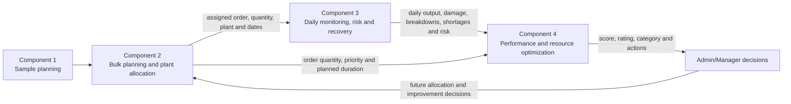
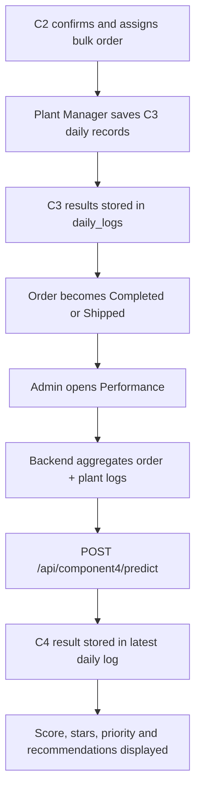
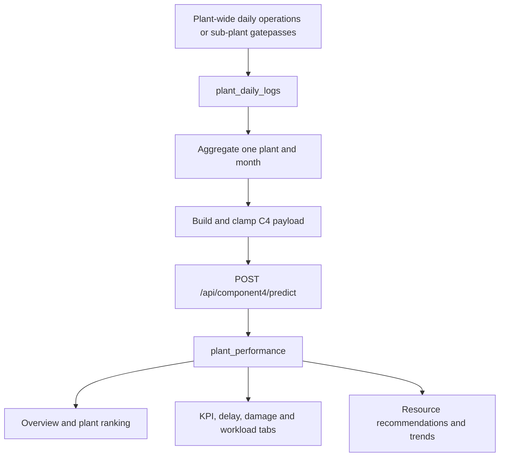
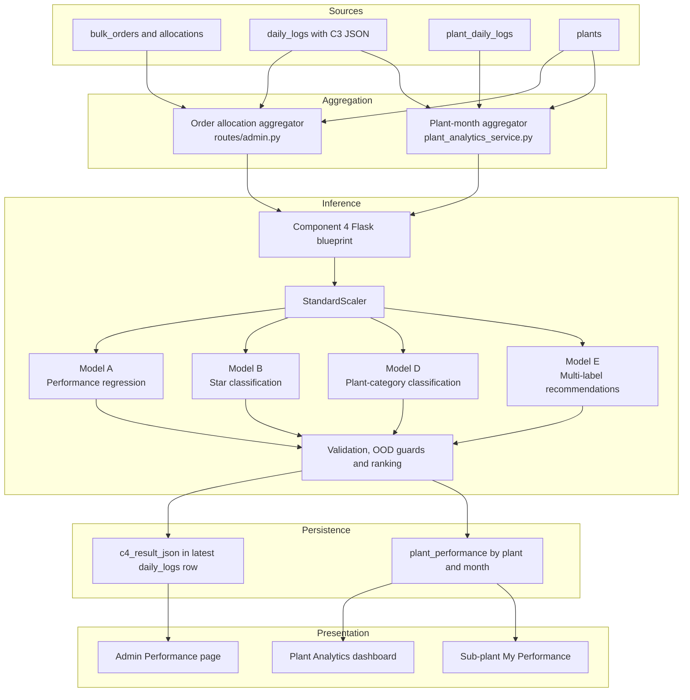
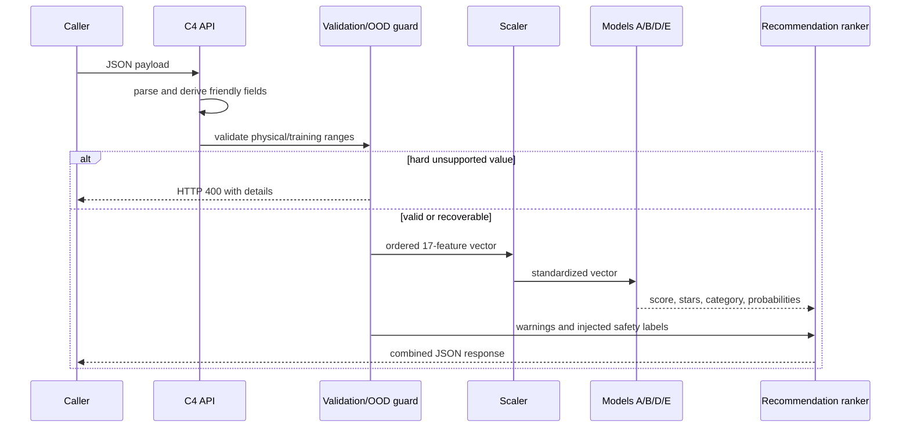
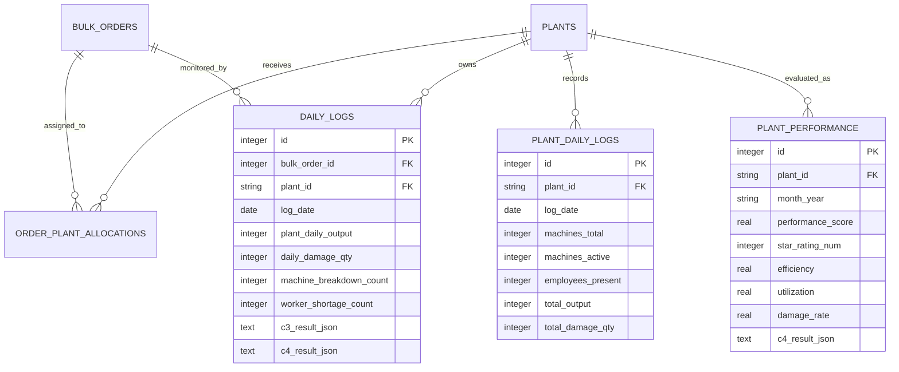

# Component 4 — Production Analysis and Resource Optimization

> Post-production performance scoring, plant analytics, and resource-optimization support for the FabricFlow Garment Production Management System

| Item | Current implementation |
| --- | --- |
| Research component | Component 4 — Production Analysis and Resource Optimization |
| Integrated system | FabricFlow Garment Production Management System |
| Repository | [IT22548146/R26-IT-002](https://github.com/IT22548146/R26-IT-002) |
| Backend | Flask API on `http://localhost:5001` |
| Frontend | Next.js application on `http://localhost:3000` |
| Direct inference API | `POST /api/component4/predict` |
| Order-performance UI | Admin → Performance |
| Plant-analytics UI | Admin/Manager → Plant Analytics |
| Dataset | `component4_production_analysis_resource_optimization_dataset.xlsx` |
| Active model artifacts | Four prediction models, one scaler, and one encoder bundle in `models/` |
| Research status | Integrated academic prototype; training-source and formal evaluation evidence must be restored before making reproducibility or production-readiness claims |

## Table of contents

- [1. Abstract](#1-abstract)
- [2. Research problem](#2-research-problem)
- [3. Limitations addressed](#3-limitations-addressed)
- [4. Aim, objectives, and research questions](#4-aim-objectives-and-research-questions)
- [5. Proposed solution and contribution](#5-proposed-solution-and-contribution)
- [6. Scope and requirements](#6-scope-and-requirements)
- [7. Integrated workflow](#7-integrated-workflow)
- [8. Component 4 architecture](#8-component-4-architecture)
- [9. Technology stack](#9-technology-stack)
- [10. Dataset](#10-dataset)
- [11. Features and preprocessing](#11-features-and-preprocessing)
- [12. Machine-learning models](#12-machine-learning-models)
- [13. Model selection and evaluation evidence](#13-model-selection-and-evaluation-evidence)
- [14. Runtime inference and safety controls](#14-runtime-inference-and-safety-controls)
- [15. Component 3 to Component 4 integration](#15-component-3-to-component-4-integration)
- [16. Plant-level monthly analytics](#16-plant-level-monthly-analytics)
- [17. Database design and persistence](#17-database-design-and-persistence)
- [18. User interfaces](#18-user-interfaces)
- [19. API reference](#19-api-reference)
- [20. Security and access control](#20-security-and-access-control)
- [21. Installation and configuration](#21-installation-and-configuration)
- [22. Running the application](#22-running-the-application)
- [23. Testing and verification](#23-testing-and-verification)
- [24. End-to-end demonstrations](#24-end-to-end-demonstrations)
- [25. Interpretation of results](#25-interpretation-of-results)
- [26. Current limitations](#26-current-limitations)
- [27. Recommended finalization work](#27-recommended-finalization-work)
- [28. Project structure and evidence map](#28-project-structure-and-evidence-map)
- [29. Thesis-use guidance](#29-thesis-use-guidance)
- [30. Conclusion](#30-conclusion)

## 1. Abstract

Component 4 is the post-production analysis and resource-optimization subsystem
of FabricFlow. It converts completed production evidence into a numerical
performance score, star rating, plant suitability category, and a ranked set
of operational recommendations.

The active inference service combines four saved machine-learning models with
deterministic validation and out-of-distribution safeguards. It uses plant
capacity, workforce, output, workload, urgency, quality, delay, and Component
3 risk signals as its inputs. The integrated application exposes the same
model through two analysis paths:

1. **Completed-order performance analysis** aggregates the daily Component 3
   records of one bulk-order allocation and presents the result in the Admin
   Performance page.
2. **Plant-month analytics** aggregates plant-wide daily operational logs,
   stores one result per plant and month, and presents cross-plant rankings,
   KPI comparisons, workload classifications, damage analysis, trends, and
   resource recommendations.

Component 4 therefore closes the FabricFlow decision loop: Component 2 assigns
production, Component 3 monitors operational risk and recovery, and Component
4 evaluates the resulting performance for future management decisions.

## 2. Research problem

Garment production managers must compare plants using several measurements at
the same time. High output alone does not prove good performance if it is
accompanied by excessive damage, repeated machine failures, worker shortages,
or deadline delays. Likewise, a single historical on-time rate does not explain
what management action should be taken next.

The problem addressed by Component 4 is:

> How can production, capacity, quality, delivery, and operational-risk
> evidence be combined to evaluate garment-plant performance and generate
> actionable resource-optimization recommendations?

The component must work within an integrated system rather than as an isolated
notebook. It must accept data created by the production workflow, preserve the
result, enforce role-based visibility, and present understandable outputs to
decision makers.

## 3. Limitations addressed

The implementation is intended to address the following limitations in manual
or fragmented performance-management processes:

1. **Single-metric evaluation** — ranking a plant using only output can hide
   quality, delay, and resource problems.
2. **Post-production data silos** — order details, daily logs, risk events,
   capacity, and final performance may exist in separate records.
3. **No use of emergency evidence** — machine breakdowns, worker shortages,
   and Component 3 risks may be omitted from final plant evaluation.
4. **Static reports** — spreadsheets show historical totals but do not provide
   a reusable prediction API or persist new analysis results.
5. **One recommendation only** — a single label cannot represent simultaneous
   quality, workforce, maintenance, and output problems.
6. **Weak decision support** — a score without a confidence value, warnings,
   priority, and suggested action is difficult to use operationally.
7. **No plant comparison** — management needs a consistent view of quality,
   on-time performance, efficiency, utilization, damage, and workload.
8. **Unsafe extrapolation** — a model may silently score values far outside its
   training range unless explicit safeguards are applied.
9. **No audit persistence** — a generated result can disappear after a page
   refresh if it is not stored in the database.

This section states the engineering problems addressed by this implementation.
A thesis literature review should support broader claims about previous
systems with peer-reviewed or authoritative external sources.

## 4. Aim, objectives, and research questions

### 4.1 Aim

To design and integrate an intelligent production-analysis component that
evaluates plant performance from operational evidence and produces practical
resource-optimization recommendations.

### 4.2 Objectives

1. Build a consistent feature representation of production and resource data.
2. Predict a continuous performance score from 1.0 to 5.0.
3. classify performance into a one-to-five-star rating.
4. Predict a suitable plant-category recommendation.
5. Generate multiple operational recommendations when several problems exist.
6. Include Component 3 risk, breakdown, and shortage evidence in the analysis.
7. Aggregate and persist both order-level and plant-month results.
8. Present performance rankings, KPI comparisons, damage status, workload
   status, trends, and recommendations in an integrated dashboard.
9. Warn or reject inputs outside the supported data range.
10. Maintain clear evidence boundaries between demonstrated runtime behaviour
    and model-training claims that require separate evaluation artifacts.

### 4.3 Research questions

- **RQ1:** Can production and plant-resource measurements estimate a continuous
  performance score?
- **RQ2:** Can the same evidence classify a plant into a meaningful star rating?
- **RQ3:** Can multiple operational improvement requirements be identified for
  the same plant or order?
- **RQ4:** Does including Component 3 risk evidence improve the completeness of
  post-production analysis?
- **RQ5:** Can the prediction service be integrated into both order-level and
  monthly plant-management workflows?

## 5. Proposed solution and contribution

The current solution provides:

- a 17-feature preprocessing contract shared by four active ML models;
- a continuous performance-score regressor;
- a five-class star-rating classifier with class probabilities;
- a three-class best-plant-category classifier;
- a seven-output multi-label recommendation classifier;
- confidence and low-confidence reporting;
- training-range validation and recoverable rule-based safeguards;
- completed-order aggregation from saved Component 3 records;
- plant-month aggregation from plant-wide daily logs;
- SQLite persistence for order-level and plant-level results;
- Admin and Manager analytics APIs;
- a cross-plant analytics dashboard; and
- self-scoped performance history for external sub-plants.

The runtime is a **hybrid decision-support system**. The main score, rating,
category, and recommendation probabilities come from saved ML artifacts.
Deterministic rules validate inputs, inject safety recommendations for extreme
but recoverable values, rank the recommendations, and generate network-level
management advice.

## 6. Scope and requirements

### 6.1 Functional requirements

- Accept plant capacity, workforce, output, workload, urgency, risk, quality,
  and delay fields.
- Derive machine utilization and delay when friendly input fields are used.
- Resolve a supported plant name to its plant identifier.
- Scale all 17 features using the saved training scaler.
- Return the performance score, star rating, confidence, star probabilities,
  plant category, recommendations, overall priority, warnings, and derived
  fields.
- Aggregate saved Component 3 order logs for completed-order analysis.
- Aggregate plant daily logs for monthly plant analysis.
- Store the latest order result and one plant result per month.
- List completed or shipped orders in the Admin Performance page.
- Rank registered plants and report external sub-plants separately.
- Provide KPI, damage, workload, recommendation, and trend endpoints.

### 6.2 Non-functional requirements

- **Explainability:** expose probabilities, warnings, derived values, and
  action labels rather than returning a score alone.
- **Reliability:** reject severely unsupported values and warn on recoverable
  out-of-distribution inputs.
- **Security:** protect portal analytics with authenticated role checks and
  derive a sub-plant's identity from its token.
- **Data integrity:** preserve plant/month uniqueness and order/plant log scope.
- **Maintainability:** separate model inference, aggregation, routes, database,
  and frontend rendering.
- **Portability:** use saved model files, SQLite, Flask, and Next.js so the
  prototype can run on a development machine without external ML hosting.
- **Auditability:** persist complete JSON predictions beside their summary
  values.

### 6.3 Out of scope in the current checkout

- automatic online retraining;
- production model registry and version promotion;
- formally documented train/validation/test split for the active C4 artifacts;
- an independently reproducible C4 training pipeline in this repository;
- causal claims that a recommendation will improve performance; and
- production approval of the saved academic models.

## 7. Integrated workflow

### 7.1 Four-component system flow



### 7.2 Completed-order analysis path



### 7.3 Plant-month analytics path



The two paths use the same C4 inference service but different source
aggregations and persistence targets.

## 8. Component 4 architecture



### 8.1 Main implementation layers

| Layer | File | Responsibility |
| --- | --- | --- |
| Model API | `components/component4.py` | Input derivation, validation, artifact loading, prediction, OOD controls, response construction |
| Order integration | `routes/admin.py` | C2/C3 aggregation, internal C4 call, result persistence, completed-order listing |
| Monthly aggregation | `services/plant_analytics_service.py` | Plant/month feature aggregation, C4 call, plant-performance persistence |
| Analytics API | `routes/analytics.py` | Rankings, KPIs, damage, workload, recommendations, sub-plants, trends |
| Database | `database/schema.py` and `database/db.py` | Daily logs and saved performance results |
| Performance UI | `frontends/src/app/(dashboard)/admin/performance/page.tsx` | Completed-order C4 execution and result cards |
| Analytics UI | `frontends/src/app/(dashboard)/admin/analytics/page.tsx` | Monthly plant analytics dashboard |
| Sub-plant API | `routes/subplant.py` | Self-scoped monthly analysis and performance history |

## 9. Technology stack

| Area | Technology | Use in Component 4 |
| --- | --- | --- |
| Backend | Python and Flask | REST endpoints and internal service calls |
| Data processing | NumPy and pandas | Feature arrays and workbook inspection/preparation |
| ML runtime | scikit-learn and joblib | Scaling, regression, classification, multi-output inference, artifact loading |
| Legacy artifact support | XGBoost | Required only by the inactive legacy C4 regressor artifact |
| Database | SQLite | Source logs, order results, and monthly plant results |
| Frontend | Next.js, React, TypeScript | Performance and analytics pages |
| HTTP client | Axios | Authenticated frontend/backend communication |
| Visualization | Recharts | Bar, pie, and comparison charts |
| Authentication | FabricFlow JWT middleware | Portal route and role enforcement |

The active C4 runtime does not require an OpenAI API key. An older unregistered
alternative implementation was removed from the runtime repository during the
legacy-code audit.

## 10. Dataset

### 10.1 Location and sheets

The bundled workbook is:

`component4_production_analysis_resource_optimization_dataset.xlsx`

| Sheet | Shape | Purpose |
| --- | ---: | --- |
| `Component4_Dataset` | 500 rows × 32 columns | Main order/plant performance dataset |
| `Plant_Ratings` | 6 rows × 9 columns | Static plant KPI and ranking reference |
| `Dashboard` | 8 rows × 9 columns | Spreadsheet summary view |

### 10.2 Main dataset fields

The 32 columns are grouped below.

| Group | Fields |
| --- | --- |
| Identity | `record_id`, `plant_id`, `plant_name`, `plant_location`, `style_id`, `buyer_name` |
| Order timeline | `order_quantity`, `production_start_date`, `order_completed_date`, `planned_completion_days`, `actual_completion_days`, `delay_days`, `delay_status` |
| Plant resources | `machine_count`, `active_machine_count`, `machine_utilization`, `employee_count`, `daily_output_avg`, `total_workload` |
| Urgency and C3 evidence | `urgent_style_flag`, `urgent_handled_count`, `risk_count_from_component3`, `machine_breakdown_days`, `worker_shortage_days` |
| Quality and delivery | `damage_rate`, `quality_rating`, `on_time_rate`, `efficiency_score` |
| Targets/outputs | `performance_score`, `star_rating`, `recommendation`, `best_plant_recommendation` |

### 10.3 Verified descriptive summary

The following values were calculated directly from the bundled workbook.

| Check | Result |
| --- | ---: |
| Records | 500 |
| Missing cells in the main sheet | 0 |
| Fully duplicated rows | 0 |
| Duplicated `record_id` values | 0 |
| Plants | 6 |
| Mean performance score | 4.2974 |
| Performance-score range | 3.90–4.77 |
| Mean delay | 1.836 days |
| Delay range | -9 to 14 days |
| Mean damage rate | 3.1418% |
| Damage-rate range | 1.89%–4.45% |

Plant record counts are:

| Plant | Records |
| --- | ---: |
| PL01 | 95 |
| PL02 | 87 |
| PL03 | 84 |
| PL04 | 100 |
| PL05 | 67 |
| PL06 | 67 |

### 10.4 Target distributions

#### Delay status

| Class | Count |
| --- | ---: |
| Delayed | 332 |
| Early | 116 |
| On Time | 52 |

#### Star rating in the workbook

| Class | Count |
| --- | ---: |
| 3 stars | 46 |
| 4 stars | 341 |
| 5 stars | 113 |

#### Single recommendation field in the workbook

| Recommendation | Count |
| --- | ---: |
| Increase daily output monitoring | 156 |
| Maintain current resource allocation | 145 |
| Reduce risk days and add supervisor monitoring | 67 |
| Improve workforce allocation | 55 |
| Increase machine maintenance support | 54 |
| Suitable for urgent style handling | 23 |

#### Best-plant category

| Category | Count |
| --- | ---: |
| Recommended for medium-high orders | 341 |
| Best for urgent/high priority orders | 113 |
| Use for normal priority orders | 46 |

### 10.5 Data-provenance boundary

The workbook is present, structurally complete, and used as the documented
source for plant mappings, KPI constants, feature ranges, and model concepts.
However, the current repository does not include the C4 data-generation notes,
training notebook, split indices, or a formal data-provenance statement.
Therefore this README describes it as the **bundled 500-record dataset** and
does not independently claim that all rows are unseen real factory records.

## 11. Features and preprocessing

### 11.1 Active 17-feature contract

The active models receive these features in this exact order:

| No. | Feature | Meaning/source |
| ---: | --- | --- |
| 1 | `machine_count` | Total plant machines |
| 2 | `active_machine_count` | Machines active during the analysed period |
| 3 | `machine_utilization` | Active machines divided by total machines |
| 4 | `employee_count` | Available/present workforce |
| 5 | `daily_output_avg` | Mean daily production output |
| 6 | `total_workload` | Total analysed workload/output |
| 7 | `order_quantity` | Assigned order quantity or monthly output proxy |
| 8 | `urgent_flag` | Binary urgency indicator |
| 9 | `urgent_handled_count` | Urgent styles/orders handled |
| 10 | `risk_count_from_component3` | Aggregated Component 3 risk evidence |
| 11 | `machine_breakdown_days` | Days with one or more breakdowns |
| 12 | `worker_shortage_days` | Days with one or more shortages |
| 13 | `quality_rating` | Plant-level static training KPI unless explicitly overridden |
| 14 | `on_time_rate` | Plant-level static training KPI unless explicitly overridden |
| 15 | `damage_rate` | Damaged pieces as a percentage of output |
| 16 | `delay_days` | Actual duration minus planned duration |
| 17 | `plant_enc` | Encoded plant identifier |

### 11.2 Friendly-input derivation

The API can derive:

```text
plant_id = lookup(plant_name)
urgent_flag = Yes/No converted to 1/0
machine_utilization = active_machine_count / machine_count
delay_days = actual_completion_days - planned_completion_days
on_time_rate = static KPI for the selected plant
quality_rating = static KPI for the selected plant
plant_enc = saved encoder mapping for plant_id
```

The caller may explicitly provide `machine_utilization`, `delay_days`,
`on_time_rate`, or `quality_rating` in the legacy/raw request format.

### 11.3 Plant encodings

| Plant ID | Encoded value |
| --- | ---: |
| PL01 | 0 |
| PL02 | 1 |
| PL03 | 2 |
| PL04 | 3 |
| PL05 | 4 |
| PL06 | 5 |

An unknown plant is encoded as `0` and returned with a warning. This behaviour
allows an external sub-plant to receive a comparative result, but it is not
evidence that the model was trained for that plant.

### 11.4 Scaling

All 17 values are converted to a `1 × 17` NumPy array and transformed with the
saved `StandardScaler` in `models/scaler.pkl`. The same scaled vector is passed
to Models A, B, D, and E.

## 12. Machine-learning models

### 12.1 Active runtime artifacts

| Model | Artifact | Estimator | Output |
| --- | --- | --- | --- |
| A | `models/model_A_perf_regressor.pkl` | `GradientBoostingRegressor` | Performance score, clipped to 1.0–5.0 |
| B | `models/model_B_star_classifier.pkl` | `GradientBoostingClassifier` | Star class and class probabilities |
| D | `models/model_D_best_plant.pkl` | `RandomForestClassifier` | Three-class plant suitability category |
| E | `models/model_E_multilabel_recommendation.pkl` | `MultiOutputClassifier` containing seven gradient-boosting classifiers | Zero or more improvement recommendations |
| Preprocessor | `models/scaler.pkl` | `StandardScaler` | Scaled 17-feature vector |
| Mappings | `models/encoders.pkl` | Python dictionary | Plant, star, recommendation, and category mappings |

The models are lazily loaded on the first prediction and cached for subsequent
requests.

### 12.2 Model A — performance score

Verified saved hyperparameters include:

| Parameter | Value |
| --- | --- |
| Estimator | Gradient Boosting Regressor |
| Number of estimators | 200 |
| Learning rate | 0.08 |
| Maximum tree depth | 4 |
| Loss | Squared error |
| Random state | 42 |

The runtime clips the predicted value to the documented 1.0–5.0 range.

### 12.3 Model B — star rating

| Parameter | Value |
| --- | --- |
| Estimator | Gradient Boosting Classifier |
| Number of estimators | 200 |
| Learning rate | 0.08 |
| Maximum tree depth | 4 |
| Loss | Log loss |
| Classes stored in artifact | 1, 2, 3, 4, 5 |
| Low-confidence threshold | 0.65 |
| Random state | 42 |

The API returns the predicted class, star symbol, maximum probability, all
class probabilities, and a low-confidence flag.

### 12.4 Model D — best-plant category

| Parameter | Value |
| --- | --- |
| Estimator | Random Forest Classifier |
| Number of trees | 200 |
| Maximum depth | 8 |
| Criterion | Gini |
| Classes | 3 |
| Random state | 42 |

The decoded categories are:

- Recommended for medium-high orders
- Use for normal priority orders
- Best for urgent/high priority orders

This output is a **category**, not a direct selection of one named plant.

### 12.5 Model E — multi-label recommendations

Model E contains seven binary gradient-boosting classifiers. Each output is
activated at probability `0.50` or higher.

| Label key | Displayed action |
| --- | --- |
| `maintenance` | Increase machine maintenance support |
| `workforce` | Improve workforce allocation |
| `risk_monitor` | Reduce risk days and add supervisor monitoring |
| `output_mon` | Increase daily output monitoring |
| `quality_act` | Quality improvement action needed |
| `urgent_ok` | Suitable for urgent style handling |
| `maintain` | Maintain current resource allocation |

If no label crosses the threshold, `maintain` is returned. When another action
is active, `maintain` is removed. Recommendations are sorted by a deterministic
severity score and assigned a priority rank.

### 12.6 Overall priority

```text
ok        -> only Maintain current resource allocation
attention -> one or two non-maintain recommendations
critical  -> three or more recommendations
```

### 12.7 Legacy and inactive C4 artifacts

The repository also contains:

| Artifact/file | Status |
| --- | --- |
| `models/model_C_recommendation.pkl` | Older single-label recommendation classifier; not loaded by current runtime |
| `models/c4_model1_perf_score.pkl` | Older 25-feature XGBoost regressor; not loaded by current runtime |
| `models/c4_model2_star_rating.pkl` | Older 25-feature star classifier; not loaded by current runtime |

These files must not be presented as active models merely because they exist
in the repository. The active artifact names are defined in `_load_models()` in
`components/component4.py`.

## 13. Model selection and evaluation evidence

### 13.1 What is verifiable now

The current repository proves:

- the exact estimator types stored in the active artifacts;
- their main saved hyperparameters;
- the 17-feature input contract;
- the class mappings and recommendation labels;
- the bundled dataset dimensions and distributions;
- successful runtime loading and inference; and
- integration of the output with the database and frontend.

### 13.2 What is not verifiable from this checkout

`components/component4.py` states that the models were produced by
`Component4_ML_Training_3.ipynb`, but that notebook is not present. No C4
training script, split manifest, comparison table, or evaluation report was
found in the current project.

Therefore the repository currently does **not** independently prove:

- the train/validation/test split method or percentages;
- whether the split was grouped by plant, order, or date;
- baseline model scores;
- candidate-model comparison scores;
- regression MAE, RMSE, or R²;
- classification accuracy, macro-F1, per-class precision/recall, or confusion
  matrices;
- multi-label micro/macro-F1, Hamming loss, or subset accuracy; or
- the exact transformations that converted the workbook's single
  recommendation column into Model E's seven binary labels.

No numerical model-accuracy claim should be added to a thesis until the
original training evidence is recovered or the models are retrained using a
versioned pipeline.

### 13.3 Evidence inconsistencies to resolve

Two artifact/dataset differences require documentation during finalization:

1. The workbook contains only 3-, 4-, and 5-star target rows, while the saved
   Model B artifact contains classes 1 through 5.
2. The workbook contains one of six recommendation strings per row, while
   active Model E predicts seven binary labels, including a quality-action
   label.

These differences may be valid results of training-time augmentation or label
engineering, but the missing training source prevents verification.

### 13.4 Runtime-version evidence

The active C4 artifacts were serialized under scikit-learn `1.6.1`, while the
current integrated environment pins scikit-learn `1.8.0`. The files load and
run, but scikit-learn may emit `InconsistentVersionWarning`.

Do not globally downgrade the integrated application only to remove this
warning, because other components—especially the current Component 3
artifacts—may then become incompatible. The safer solution is to recover the
C4 training pipeline, retrain under the project's current locked environment,
and regenerate the artifacts and evaluation reports together.

## 14. Runtime inference and safety controls

### 14.1 Request processing sequence



### 14.2 Hard rejection limits

The API rejects values beyond these supported boundaries:

| Field | Rejected when |
| --- | --- |
| `machine_count` | below 8 or above 22 |
| `employee_count` | above 68 |
| `daily_output_avg` | above 1088.2 |
| `order_quantity` | above 59,951 |
| `urgent_handled_count` | above 6 |

The plant-month aggregation service clamps selected values to supported ranges
before calling the model. This prevents API failure but also means the model
receives a bounded proxy rather than the original extreme value. Both the raw
operational metrics and C4 payload should be retained for audit interpretation.

### 14.3 Recoverable OOD warnings and overrides

| Condition | Runtime action |
| --- | --- |
| Machine utilization below 0.60 | Warn and inject maintenance recommendation |
| Employee count below 28 | Warn and inject workforce recommendation |
| Active machines below 5 | Warn and inject maintenance recommendation |
| Daily output below 84.9 | Warn and inject output-monitoring recommendation |
| Order quantity below 2,017 | Warn only; valid small C2 allocations remain supported |
| Breakdown days above 6 | Warn and inject maintenance recommendation |
| Shortage days above 8 | Warn and inject workforce recommendation |
| C3 risk count above 16 | Warn and inject risk-monitoring recommendation |
| Damage rate above 4.45% | Warn and inject quality-action recommendation |
| Damage rate below 1.89% | Warn that prediction reliability may be reduced |

These injected actions are deterministic safety overrides, not additional ML
predictions. The response keeps their probability/severity fields in the same
recommendation structure for frontend compatibility.

### 14.4 Static KPI values

When not explicitly supplied, `on_time_rate` and `quality_rating` come from the
following static map derived from the bundled plant sheet:

| Plant | On-time rate | Quality rating |
| --- | ---: | ---: |
| PL01 | 0.92 | 4.8 |
| PL02 | 0.88 | 4.5 |
| PL03 | 0.85 | 4.3 |
| PL04 | 0.83 | 4.2 |
| PL05 | 0.80 | 4.0 |
| PL06 | 0.78 | 3.8 |

They are plant-level constants in the current runtime, not dynamically
recalculated order outcomes. This is an important limitation because they are
also influential model features.

## 15. Component 3 to Component 4 integration

### 15.1 Source records

The completed-order route reads `daily_logs` for a selected combination of:

- `bulk_order_id`; and
- `plant_id`.

This plant scope is important for split orders because two plants may work on
the same bulk order.

### 15.2 C3 fields aggregated for C4

| C4 input/result field | Source/calculation |
| --- | --- |
| Number of analysed days | Count of order/plant `daily_logs` rows |
| Average daily output | Mean of `plant_daily_output` |
| Total output | Sum of `plant_daily_output` |
| Damage rate | Sum of `daily_damage_qty` ÷ total output × 100 |
| Machine breakdown days | Count of days where `machine_breakdown_count > 0` |
| Worker shortage days | Count of days where `worker_shortage_count > 0` |
| C3 risk count | Count where `c3_result_json.risk_detection.risk_status == "Risk"` |
| Critical C3 days | Count where C3 severity is `Critical` |
| Recovery-required days | Count where recovery status is `recovery_required` |

### 15.3 C2 and plant fields added

| C4 field | Source |
| --- | --- |
| Plant name/location | Assigned `plants` row |
| Order quantity | Allocation quantity, falling back to bulk order quantity |
| Planned completion days | C2 `production_days.total_production_days`, falling back to log count |
| Actual completion days | Number of saved daily logs |
| Machine count | Plant master record |
| Employee count | Plant master record |
| Urgent flag | C2/bulk-order style priority |
| Total workload | Allocated quantity |

### 15.4 Internal call and persistence

`GET /admin/orders/bulk/<order_id>/analysis?plant_id=<plant_id>` builds the
payload and internally posts it to `/api/component4/predict`. A successful
response is stored in `c4_result_json` on the latest relevant `daily_logs` row.

The returned response also contains:

- order and style identifiers;
- buyer, plant, and location;
- allocated quantity;
- number of logs analysed;
- C3 risk-event count;
- critical-risk-day count;
- recovery-required-day count; and
- the full Component 4 result.

### 15.5 When an order appears in Performance

The Admin Performance list only includes bulk orders whose status is:

- `Completed`; or
- `Shipped`.

The Run Analysis button is disabled when no production logs exist.

## 16. Plant-level monthly analytics

### 16.1 Plant daily source

`plant_daily_logs` stores one plant-wide row per plant and date with:

- total and active machines;
- employees present;
- breakdown and shortage counts;
- total output and total damage;
- urgent orders handled;
- notes and submitting user.

This table is separate from order-specific `daily_logs`. Sub-plant gatepasses
are rolled into `plant_daily_logs` so the same C4 monthly pipeline can analyse
external plants.

### 16.2 Monthly aggregation formulas

```text
working_days = number of plant daily logs in month
total_output = sum(total_output)
total_damage = sum(total_damage_qty)
average_output = total_output / working_days
damage_rate = total_damage / total_output × 100
machine_utilization = average active machines / average total machines
efficiency = total_output / (average machines × 28 pieces × working_days)
planned_days = working_days
actual_days = round(planned_days / efficiency), capped at 3 × planned_days
delay_ratio = max(0, actual_days - planned_days) / planned_days
```

The current nominal ceiling is 28 pieces per machine per day.

The monthly `risk_count_from_component3` is the number of order-log C3 results
for that plant/month whose severity is `Critical`.

### 16.3 Stored monthly outputs

A successful monthly run inserts or replaces one `plant_performance` record for
the selected plant/month. Summary columns support fast dashboard queries while
`c4_result_json` preserves the complete model response.

### 16.4 Analytics views

The Plant Analytics page provides:

- overview KPIs;
- plant performance ranking;
- KPI comparison;
- delay and damage analysis using a 3% damage threshold;
- workload classification;
- network-level resource recommendations;
- external sub-plant analysis; and
- per-plant monthly trends.

Workload is classified as:

| Status | Current rule |
| --- | --- |
| Underutilized | Efficiency/load ratio below 0.72 |
| Overloaded | Utilization above 0.92 after not being underutilized |
| Optimal | Neither condition is met |

Network-level recommendation messages in `routes/analytics.py` are
deterministic management rules based on stored C4 and KPI results. They should
not be confused with Model E's per-analysis recommendation probabilities.

## 17. Database design and persistence

### 17.1 Relevant tables



### 17.2 Data-integrity constraints

- `daily_logs` is unique by bulk order, plant, and log date.
- `plant_daily_logs` is unique by plant and log date.
- `plant_performance` is unique by plant and month.
- Monthly analysis uses `INSERT OR REPLACE`, so re-running recalculates the
  same plant/month instead of creating duplicate score rows.
- Order analysis stores the result on the latest order/plant daily log.

### 17.3 Input data is not stored in model files

The `.pkl` files contain trained estimators and preprocessing state. User-entered
production data is stored in `garment.db`. Removing a model file prevents its
prediction from running but does not delete saved database rows. Removing or
replacing `garment.db`, however, can remove operational data unless a backup is
kept.

## 18. User interfaces

### 18.1 Admin Performance

Route: `http://localhost:3000/admin/performance`

Purpose:

- list completed/shipped bulk-order allocations;
- display buyer, plant, location, quantity, and log count;
- run or re-run C4 order analysis; and
- show star rating, performance score, priority, and recommendations.

This page is available in the Admin navigation. The current frontend blocks the
Manager role from the Performance sub-route even though the backend analysis
endpoint accepts both Admin and Manager.

### 18.2 Plant Analytics

Route: `http://localhost:3000/admin/analytics`

Purpose:

- select a month;
- run C4 for all plants with logs;
- inspect overview, KPI, delay/damage, workload, recommendation, and sub-plant
  tabs; and
- view charts and cross-plant rankings.

This page is available to Admin and Manager roles.

### 18.3 External sub-plant performance

The separate sub-plant portal can:

- create gatepasses that feed plant daily logs;
- run C4 only for the authenticated sub-plant; and
- display its own monthly performance history.

The backend derives the plant identifier from the authentication token rather
than accepting another plant ID from the request body.

## 19. API reference

### 19.1 Health check

```http
GET /api/component4/health
```

Example response:

```json
{
  "component": "4 — Production Analysis & Resource Optimization",
  "status": "ok"
}
```

### 19.2 Direct prediction

```http
POST /api/component4/predict
Content-Type: application/json
```

Friendly request example:

```json
{
  "plant_name": "MRC Group",
  "order_quantity": 12000,
  "planned_completion_days": 28,
  "actual_completion_days": 33,
  "machine_count": 16,
  "active_machine_count": 11,
  "employee_count": 48,
  "daily_output_avg": 450,
  "total_workload": 18000,
  "urgent_style_flag": "Yes",
  "urgent_handled_count": 2,
  "risk_count_from_component3": 6,
  "machine_breakdown_days": 4,
  "worker_shortage_days": 2,
  "damage_rate": 3.2
}
```

Representative response structure:

```json
{
  "status": "success",
  "plant_id": "PL02",
  "performance_score": 4.12,
  "star_rating": "⭐⭐⭐⭐",
  "star_rating_num": 4,
  "confidence": 0.91,
  "star_probabilities": {
    "1★": 0.0,
    "2★": 0.0,
    "3★": 0.04,
    "4★": 0.91,
    "5★": 0.05
  },
  "low_confidence_flag": false,
  "overall_priority": "attention",
  "best_plant_category": "Recommended for medium-high orders",
  "recommendations": [
    {
      "action": "Increase machine maintenance support",
      "label_key": "maintenance",
      "probability": 0.8,
      "severity_score": 0.04,
      "priority_rank": 1
    }
  ],
  "warnings": [],
  "derived": {
    "plant_id": "PL02",
    "plant_enc": 1,
    "urgent_flag": 1,
    "machine_utilization": 0.6875,
    "on_time_rate": 0.88,
    "quality_rating": 4.5,
    "delay_days": 5.0,
    "damage_rate": 3.2
  }
}
```

The numbers above illustrate the response schema; they are not published
evaluation metrics.

### 19.3 Completed-order endpoints

| Method and path | Role | Purpose |
| --- | --- | --- |
| `GET /admin/performance` | Admin | List completed/shipped allocations and stored C4 results |
| `GET /admin/orders/bulk/<id>/analysis?plant_id=<plant>` | Admin, Manager | Aggregate C2/C3 data, run C4, and store the result |

### 19.4 Plant analytics endpoints

All endpoints below require Admin or Manager unless otherwise stated.

| Method and path | Purpose |
| --- | --- |
| `POST /analytics/analyze` | Analyse every plant with logs for a month |
| `POST /analytics/plants/<plant_id>/analyze` | Analyse one plant/month |
| `GET /analytics/months` | List months containing plant logs |
| `GET /analytics/overview?month=YYYY-MM` | Headline KPIs and ranking |
| `GET /analytics/kpi-comparison?month=YYYY-MM` | Per-plant KPI matrix |
| `GET /analytics/delay-damage?month=YYYY-MM` | Damage bands and delay status |
| `GET /analytics/workload?month=YYYY-MM` | Underutilized/Optimal/Overloaded classification |
| `GET /analytics/recommendations?month=YYYY-MM` | Network-level resource advice |
| `GET /analytics/sub-plants?month=YYYY-MM` | External sub-plant analytics |
| `GET /analytics/plants/<plant_id>/trend` | Monthly history for one plant |
| `GET /analytics/plants/<plant_id>/aggregate?month=YYYY-MM` | Preview exact C4 payload without running inference |

### 19.5 Sub-plant endpoints

| Method and path | Role | Purpose |
| --- | --- | --- |
| `POST /subplant/performance/analyze` | SubPlant | Run C4 for the authenticated plant/month |
| `GET /subplant/performance/months` | SubPlant | List its available months |
| `GET /subplant/performance` | SubPlant | View only its own monthly trend |

## 20. Security and access control

### 20.1 Implemented controls

- Portal analytics endpoints use `require_role`.
- The completed Performance list is Admin-only.
- The order-analysis backend accepts Admin and Manager.
- Plant Analytics accepts Admin and Manager.
- A sub-plant can analyse only the plant ID stored in its token.
- The frontend Axios client sends the stored JWT in the `Authorization` header.
- CORS origins are configured through `CORS_ORIGINS`.
- Parameterised SQLite queries are used for the documented routes.

### 20.2 Current security limitation

The direct endpoints `/api/component4/health` and
`/api/component4/predict` do not currently have a `require_role` decorator.
They are called internally by protected portal routes, but a client that can
reach the backend can also call the prediction endpoint directly.

Before production deployment, protect the direct model route with service
authentication or keep it on a private internal network. Do not add a role
decorator without also updating the current internal Flask test-client calls,
because they presently do not forward a user token.

## 21. Installation and configuration

### 21.1 Prerequisites

- Python supported by the current project environment
- Node.js and npm
- the active C4 model files in `models/`
- the project SQLite database, or permission to initialize a new one

### 21.2 Backend setup on macOS/Linux

```bash
cd "/Users/vanu/Desktop/Y4S1:S2/Research/research new/Garment_model_backend_latest"
python3 -m venv .venv
source .venv/bin/activate
python -m pip install -r requirements.txt
cp .env.example .env
```

Minimum local `.env` values:

```env
HOST=0.0.0.0
PORT=5001
FLASK_DEBUG=false
SECRET_KEY=replace-with-a-random-secret
DATABASE_PATH=garment.db
CORS_ORIGINS=http://localhost:3000,http://127.0.0.1:3000
```

Component 4 does not require Gmail credentials or an OpenAI key for active
saved-model inference.

### 21.3 Frontend setup

```bash
cd frontends
npm install
cp .env.example .env.local
```

`frontends/.env.local`:

```env
NEXT_PUBLIC_API_URL=http://localhost:5001
NEXT_PUBLIC_COMPONENT3_API_URL=http://localhost:5001/api/component3
```

## 22. Running the application

Use two terminals.

### Terminal 1 — Flask backend

```bash
cd "/Users/vanu/Desktop/Y4S1:S2/Research/research new/Garment_model_backend_latest"
source .venv/bin/activate
python main.py
```

Backend URL: `http://localhost:5001`

### Terminal 2 — Next.js frontend

```bash
cd "/Users/vanu/Desktop/Y4S1:S2/Research/research new/Garment_model_backend_latest/frontends"
npm run dev
```

Frontend URL: `http://localhost:3000`

### Quick health checks

```bash
curl http://localhost:5001/health
curl http://localhost:5001/api/component4/health
```

## 23. Testing and verification

### 23.1 Direct smoke test

With the backend running:

```bash
curl -X POST http://localhost:5001/api/component4/predict \
  -H "Content-Type: application/json" \
  -d '{
    "plant_name": "MRC Group",
    "order_quantity": 12000,
    "planned_completion_days": 28,
    "actual_completion_days": 33,
    "machine_count": 16,
    "active_machine_count": 11,
    "employee_count": 48,
    "daily_output_avg": 450,
    "total_workload": 18000,
    "urgent_style_flag": "Yes",
    "urgent_handled_count": 2,
    "risk_count_from_component3": 6,
    "machine_breakdown_days": 4,
    "worker_shortage_days": 2,
    "damage_rate": 3.2
  }'
```

Expected behaviour:

- HTTP 200;
- `status` equals `success`;
- performance score remains within 1.0–5.0;
- star rating and class probabilities are present;
- recommendations and derived fields are present; and
- compatibility warnings may appear in the backend console during first model
  load because of the saved scikit-learn version.

### 23.2 Integrated order test

1. Create and confirm a Component 2 bulk order.
2. Assign it to a plant.
3. Log in as that plant's manager.
4. Save multiple Component 3 daily monitoring records.
5. Complete the order.
6. Log in as Admin and open Performance.
7. Click Run Analysis.
8. Confirm that score, stars, priority, and recommendations appear.
9. Refresh the page and confirm the stored result remains visible.

### 23.3 Integrated monthly test

1. Ensure a month contains `plant_daily_logs` rows.
2. Log in as Admin or Manager.
3. Open Plant Analytics and select that month.
4. Click Run Analysis.
5. Confirm analysed/skipped/failed counts.
6. Verify Overview, KPI Comparison, Delay & Damage, Workload,
   Recommendations, and Sub Plants tabs.
7. Re-run the same month and confirm it updates rather than duplicates each
   plant/month row.

### 23.4 Current automated-test gap

The current `tests/` directory contains no dedicated Component 4 test module.
Runtime and UI demonstrations provide useful evidence, but they do not replace
repeatable automated regression tests.

Recommended test modules are:

- `tests/test_component4_api.py`
- `tests/test_component4_order_integration.py`
- `tests/test_component4_plant_analytics.py`
- `tests/test_component4_access_control.py`
- `tests/test_component4_model_contract.py`

They should cover valid prediction, missing fields, unknown plants, hard OOD
rejection, recoverable OOD injection, low confidence, split-order plant scope,
monthly aggregation, persistence, and role isolation.

## 24. End-to-end demonstrations

### 24.1 C2 → C3 → C4 order demonstration

1. **Admin/Buyer workflow:** create and confirm a bulk order in Component 2.
2. **Admin:** assign the order to a registered plant.
3. **Plant Manager:** select the assigned order in Emergency Monitoring.
4. **Plant Manager:** enter actual daily output, damage, breakdown, and worker
   shortage data.
5. **Component 3:** run risk analysis and save the daily monitoring record.
6. Repeat daily monitoring for the required demonstration days.
7. Complete or ship the bulk order.
8. **Admin:** open Performance.
9. Click **Run Analysis** for the correct plant allocation.
10. Explain that C4 receives aggregated C2 order values and C3 daily evidence.
11. Show the performance score, star rating, overall priority, and ranked
    recommendations.
12. Refresh to prove that the result is persisted.

### 24.2 Monthly resource-optimization demonstration

1. Open Plant Analytics as Admin or Manager.
2. Select a month containing plant daily logs.
3. Click **Run Analysis**.
4. Show the best-plant ranking and average network KPIs.
5. Compare quality, on-time, efficiency, utilization, damage, and workload.
6. Explain the 3% damage threshold.
7. Show the Underutilized/Optimal/Overloaded classification.
8. Show the deterministic network recommendations.
9. Open Sub Plants and explain that unknown plants are reported separately and
   carry a model-training warning.

### 24.3 Suggested presentation explanation

> Component 4 does not analyse output alone. It combines plant resources,
> productivity, quality, schedule performance, urgency, and the operational
> risks collected by Component 3. Four saved ML models produce the score,
> rating, plant category, and multi-label recommendations. The integrated
> application then validates the inputs, ranks actions, saves the result, and
> exposes both completed-order and monthly plant-level decision views.

## 25. Interpretation of results

### 25.1 Performance score

The score is a model estimate constrained to 1.0–5.0. It is useful for relative
decision support within the supported data range. It is not a financial audit,
contractual quality grade, or causal measurement of management performance.

### 25.2 Star rating and confidence

The star rating is a separate classifier output, not simply the rounded
performance score. `confidence` is the maximum predicted class probability.
When it is below 0.65, the response requests manual review.

### 25.3 Best-plant category

Model D predicts one of three suitability categories. It does not return a
specific plant name and should not be described as an autonomous plant
allocation decision.

### 25.4 Recommendations

Model E can return several improvement areas. The API sorts them using
configured severity weights and feature deviation. OOD rules can add an action
when an input falls beyond the supported range. Therefore the final list is a
hybrid of model probabilities and explicit safety/business logic.

### 25.5 C3 evidence

The C3 risk count represents saved operational-risk detections. It improves
traceability between daily monitoring and post-production analysis, but a risk
count should not be interpreted as proof that every event caused the final
performance result.

## 26. Current limitations

1. The referenced C4 training notebook is missing from the current repository.
2. Formal C4 model-comparison and evaluation reports are absent.
3. The exact training split and leakage-control strategy cannot be verified.
4. Active artifacts were serialized under scikit-learn 1.6.1 while runtime is
   currently 1.8.0.
5. Static `on_time_rate` and `quality_rating` values strongly influence the
   models and do not change per live order unless explicitly overridden.
6. The bundled workbook's target distributions do not fully match the active
   Model B and Model E artifact contracts.
7. Unknown sub-plants fall back to the PL01 encoding value and therefore
   receive comparative, not plant-specific, predictions.
8. Monthly aggregation clamps some values into the supported range; this keeps
   inference running but can hide the magnitude of an extreme condition unless
   raw metrics are reviewed alongside the C4 result.
9. The direct prediction endpoint is not authenticated.
10. There are no dedicated automated C4 tests in the current test suite.
11. Order-level and plant-month analysis coexist and use the same model, so the
    interpretation of `order_quantity`, `total_workload`, and duration differs
    by aggregation path.
12. Model feature importance is not causal importance and should not be used to
    justify operational interventions by itself.

## 27. Recommended finalization work

### Priority 1 — reproducible ML evidence

1. Recover or recreate `Component4_ML_Training_3.ipynb` as a version-controlled
   script or notebook.
2. Define the authoritative dataset-generation and label-engineering process.
3. Use a leakage-safe split appropriate to the research question, such as a
   group split by plant/order and a chronological holdout where possible.
4. Compare each selected model with a simple baseline.
5. Save metrics, confusion matrices, residual plots, split identifiers,
   feature schema, package versions, and random seeds.
6. Retrain all active artifacts under the current locked environment.

### Priority 2 — model and data contract

1. Reconcile workbook star classes with Model B's five stored classes.
2. Document how seven multi-label targets are produced for Model E.
3. Replace static plant KPI inputs with calculated historical/live KPIs or
   explicitly define them as prior information.
4. Version the feature schema beside every artifact.
5. Replace unknown-plant fallback encoding with an explicit supported strategy.

### Priority 3 — software quality

1. Add the five C4 automated test modules described above.
2. Protect the direct C4 prediction API or isolate it as an internal service.
3. Add structured logging for model version, payload version, warnings, and
   prediction latency.
4. Add database/model backups before cleanup or artifact replacement.
5. Decide whether order-level and plant-month analysis are both required; if
   both remain, document separate payload versions and interpretation.

### Priority 4 — research validation

1. Evaluate on unseen orders and plants where possible.
2. Report class imbalance and per-class metrics, not accuracy alone.
3. Measure recommendation precision/recall per label.
4. Evaluate calibration of Model B probabilities.
5. Conduct user evaluation with production managers for usefulness,
   understandability, and actionability.

## 28. Project structure and evidence map

```text
Garment_model_backend_latest/
├── app.py
├── main.py
├── requirements.txt
├── component4_production_analysis_resource_optimization_dataset.xlsx
├── components/
│   └── component4.py
├── models/
│   ├── model_A_perf_regressor.pkl
│   ├── model_B_star_classifier.pkl
│   ├── model_D_best_plant.pkl
│   ├── model_E_multilabel_recommendation.pkl
│   ├── scaler.pkl
│   ├── encoders.pkl
│   ├── model_C_recommendation.pkl          # inactive legacy artifact
│   ├── c4_model1_perf_score.pkl            # inactive legacy artifact
│   └── c4_model2_star_rating.pkl           # inactive legacy artifact
├── database/
│   ├── schema.py
│   ├── db.py
│   └── seed_plant_performance.py
├── routes/
│   ├── admin.py
│   ├── analytics.py
│   └── subplant.py
├── services/
│   └── plant_analytics_service.py
└── frontends/src/app/(dashboard)/admin/
    ├── performance/page.tsx
    └── analytics/page.tsx
```

### Evidence lookup

| Claim | Primary implementation evidence |
| --- | --- |
| Active C4 models and feature order | `components/component4.py` |
| Model files used at runtime | `_load_models()` in `components/component4.py` |
| C3-to-C4 order aggregation | `bulk_order_analysis()` in `routes/admin.py` |
| Completed-order access rules | `performance_list()` in `routes/admin.py` |
| Plant-month formulas | `aggregate_plant_month()` in `services/plant_analytics_service.py` |
| Monthly result persistence | `analyze_plant_month()` in `services/plant_analytics_service.py` |
| Analytics endpoints | `routes/analytics.py` |
| Sub-plant self-scope | C4 routes in `routes/subplant.py` |
| Database tables | `database/schema.py` |
| Performance UI | `frontends/src/app/(dashboard)/admin/performance/page.tsx` |
| Monthly dashboard | `frontends/src/app/(dashboard)/admin/analytics/page.tsx` |
| Dataset fields/distributions | Bundled Component 4 Excel workbook |

## 29. Thesis-use guidance

### 29.1 Claims currently supported by repository evidence

The thesis can accurately state that:

- Component 4 is integrated with the FabricFlow Flask and Next.js system.
- It uses four active saved ML models plus a scaler and encoders.
- It accepts 17 capacity, production, risk, quality, delay, and plant features.
- Component 3 daily evidence is aggregated into the completed-order C4 input.
- Results are persisted and displayed in order-level and monthly analytics UIs.
- Runtime safeguards warn or reject unsupported values.
- The bundled workbook contains 500 complete rows across six plants.

### 29.2 Claims requiring additional evidence

Do not claim the following until the missing training pipeline and reports are
recovered or recreated:

- that a particular train/test percentage was used;
- that a particular algorithm achieved a stated accuracy, F1, MAE, RMSE, or R²;
- that Model A/B/D/E was selected because it outperformed named alternatives;
- that the 500 rows are all independent unseen real-world observations;
- that the model generalizes to external sub-plants; or
- that the system is production approved.

### 29.3 Suggested thesis subsection structure

1. Research problem and objectives
2. Related work and limitations
3. Proposed Component 4 architecture
4. Dataset and provenance
5. Data preprocessing and feature engineering
6. Model candidates, baselines, and selection method
7. Leakage-safe experimental design
8. Evaluation metrics and results
9. Runtime inference and safety controls
10. C2/C3/C4 integration
11. User interface and database persistence
12. Security and access control
13. Testing and user evaluation
14. Limitations and future work

### 29.4 Recommended ML metrics

| Task | Minimum metrics |
| --- | --- |
| Model A regression | MAE, RMSE, R², residual distribution |
| Model B multiclass classification | Accuracy, macro-F1, weighted-F1, per-class precision/recall, confusion matrix, calibration |
| Model D multiclass classification | Accuracy, macro-F1, per-class results, confusion matrix |
| Model E multi-label classification | Micro-F1, macro-F1, per-label precision/recall/F1, Hamming loss, subset accuracy |

All final results should report the split unit, number of independent plants or
orders, class support, random seed, software versions, and whether any tuning
used validation rather than test data.

## 30. Conclusion

Component 4 is functionally integrated as FabricFlow's production-performance
and resource-optimization layer. The active runtime loads four saved ML models,
combines production and Component 3 risk evidence, applies validation and OOD
safeguards, persists results, and supports both completed-order and monthly
plant analytics.

The implementation evidence is strong enough to demonstrate the end-to-end
software workflow. The main remaining research-quality gap is reproducibility:
the original C4 training pipeline and formal evaluation outputs are not present
in the current checkout. Restoring or recreating that pipeline, retraining under
the current environment, and adding automated C4 tests are the highest-value
steps before thesis submission or production use.
