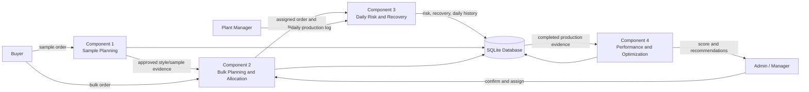
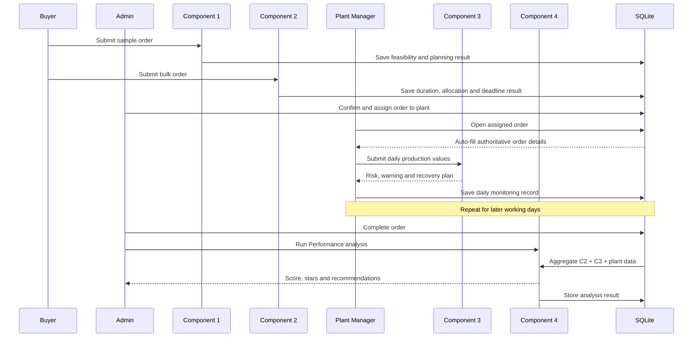
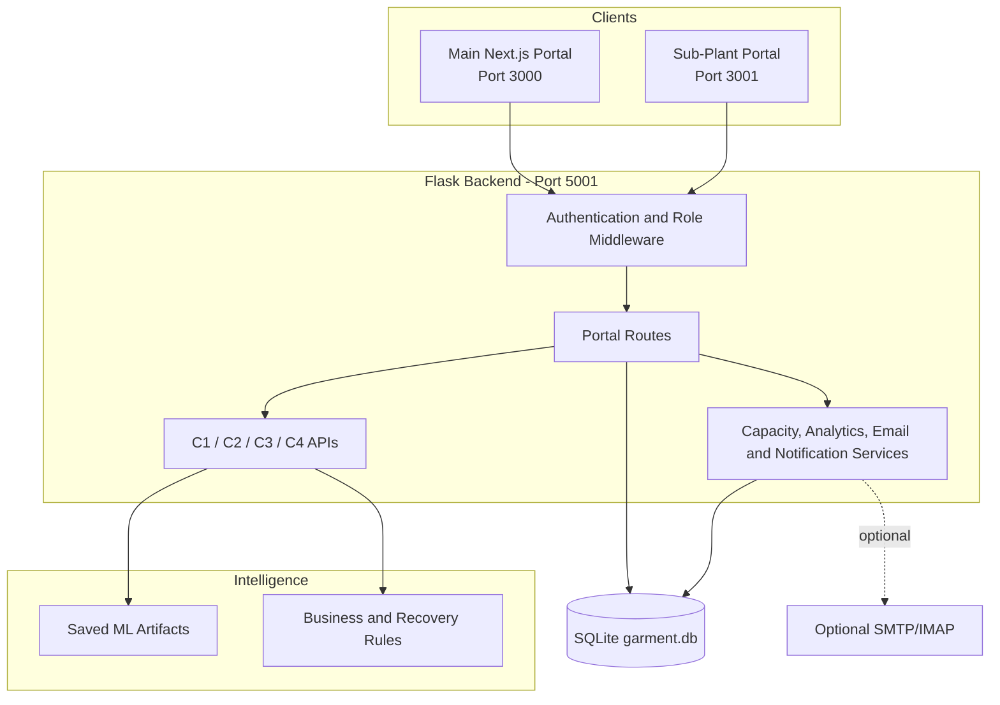

# FabricFlow — AI-Assisted Garment Production Planning, Monitoring, and Optimization

> Integrated research implementation containing four connected decision-support components for garment production management

| Item | Details |
| --- | --- |
| Project name | FabricFlow Garment Production Management System |
| Research domain | Artificial Intelligence, Data Science, Software Engineering, and Garment Manufacturing |
| System type | Role-based web application with machine-learning and rule-based decision support |
| Backend | Flask REST API — `http://localhost:5001` |
| Main frontend | Next.js portal — `http://localhost:3000` |
| Sub-plant frontend | Next.js portal — `http://localhost:3001` |
| Database | SQLite (`garment.db`) |
| Repository | [IT22548146/R26-IT-002](https://github.com/IT22548146/R26-IT-002) |
| Implementation status | Integrated academic prototype; not production approved |

## Table of Contents

- [Research Proposal](#research-proposal)
- [Project Description](#project-description)
- [Literature Survey](#literature-survey)
- [Research Gap](#research-gap)
- [Research Problem](#research-problem)
- [Research Objectives](#research-objectives)
  - [Main Objective](#main-objective)
  - [Specific Objectives](#specific-objectives)
- [Methodology](#methodology)
- [Technologies Used](#technologies-used)
- [System Components](#system-components)
  - [Component 1](#component-1--sample-planning-system)
  - [Component 2](#component-2--bulk-order-planning-and-capacity-allocation)
  - [Component 3](#component-3--emergency-situation-detection-and-management)
  - [Component 4](#component-4--production-analysis-and-resource-optimization)
- [Integrated Data Flow](#integrated-data-flow)
- [System Architecture](#system-architecture)
- [Datasets and Evidence](#datasets-and-evidence)
- [User Roles](#user-roles)
- [Functional Requirements](#functional-requirements)
- [Non-Functional Requirements](#non-functional-requirements)
- [Testing and Validation](#testing-and-validation)
- [How to Run the Project](#how-to-run-the-project)
- [Demonstration Workflow](#demonstration-workflow)
- [Research Contributions](#research-contributions)
- [Limitations](#limitations)
- [Future Work](#future-work)
- [Project Structure](#project-structure)
- [Research Integrity and Claim Boundaries](#research-integrity-and-claim-boundaries)
- [References](#references)

# Research Proposal

## Proposed Title

**FabricFlow: An Integrated AI-Assisted Framework for Garment Production
Planning, Capacity Allocation, Emergency Management, and Performance
Optimization**

## Background

Garment production is a multi-stage process involving sample approval, bulk
order planning, plant selection, cutting, embroidery, sewing, quality control,
packing, shipment, and delivery. Each stage depends on limited resources,
buyer deadlines, plant capacity, workforce availability, machine condition,
quality targets, and daily production progress.

When these activities are managed using isolated spreadsheets or separate
applications, decision makers may not receive a consistent view of the full
order lifecycle. A sample-order decision may not be connected to bulk
allocation. Daily production emergencies may not be considered when final
plant performance is evaluated. Problems may therefore be identified only
after production has already fallen behind schedule.

FabricFlow proposes an integrated, data-driven decision-support system that
connects four research components:

1. sample planning;
2. bulk-order planning and capacity allocation;
3. emergency situation detection and management; and
4. post-production analysis and resource optimization.

The solution combines machine-learning models, deterministic business rules,
historical and live operational data, role-based access control, persistent
database records, and web-based user interfaces.

## Proposed Approach

The research follows an end-to-end garment-order lifecycle. Component 1
analyses the feasibility and production risk of a sample order. Component 2
estimates production duration, determines single-plant or split allocation,
and evaluates deadline feasibility for the resulting bulk order. Component 3
monitors the assigned order daily, detects risks such as worker shortages,
machine breakdowns, quality issues, and output gaps, and generates a recovery
plan. After production, Component 4 aggregates the operational evidence and
produces a performance score, star rating, plant category, and ranked resource
recommendations.

The integrated application supports Buyers, Administrators, Managers, Plant
Managers, and external Sub-Plants through separate role-based workflows.

## Expected Research Contribution

The expected contribution is not a single prediction model. It is an
integrated decision-support framework that:

- connects planning, execution monitoring, recovery, and evaluation;
- reuses order data between components instead of requiring repeated manual
  entry;
- combines machine learning with explainable rules and validation;
- preserves daily operational and model evidence for later analysis;
- restricts plant data according to the authenticated user;
- supports proactive intervention before a buyer deadline is missed; and
- creates a feedback loop from completed production to future allocation
  decisions.

# Project Description

FabricFlow is a full-stack garment production management application. The
backend is a Flask REST API, the main portal is implemented with Next.js and
React, and operational data is stored in SQLite. Saved scikit-learn and
XGBoost artifacts perform the active ML inference.

The application includes:

- buyer registration and approval;
- style and sample-order submission;
- sample feasibility analysis;
- bulk-order planning;
- single/split plant assignment;
- capacity and allocation management;
- Plant Manager approval and production-stage tracking;
- daily production logging;
- emergency-risk prediction;
- recovery-plan generation and tracking;
- daily monitoring and recovery history;
- notifications and email integration;
- completed-order performance scoring;
- monthly plant analytics and ranking; and
- external sub-plant operational and performance workflows.

## End-to-End Project View



## Project Scope

The current project focuses on decision support for garment sample and bulk
orders across six registered plants, with additional support for external
sub-plants. It is an academic prototype designed for local development and
demonstration. It does not autonomously operate machinery, replace responsible
production managers, or constitute a production-certified enterprise resource
planning system.

# Literature Survey

## Garment Production Planning and Scheduling

Production planning in apparel manufacturing has long been treated as a
constrained scheduling problem. An early make-to-order apparel scheduling
system used operator-efficiency estimates and simulated annealing to generate
daily schedules, illustrating the importance of operator and process data in
production planning [1]. Later research formulated fashion-apparel production
planning under uncertainty using plant location, lead time, production cost,
transport cost, tardiness, and demand-risk constraints [2].

Recent multi-line garment research continues to show that lot streaming,
heterogeneous workforce allocation, and makespan optimization must be handled
together rather than as independent decisions. Mixed-integer programming can
provide a benchmark, while evolutionary algorithms can produce useful
solutions for larger industrial instances [3].

These findings support FabricFlow Components 1 and 2, which consider buyer
deadlines, plant capacity, style complexity, process duration, and single/split
allocation. FabricFlow differs in implementation scope by connecting those
planning decisions to live order monitoring and final performance analysis.

## Machine Learning for Risk and Disruption Prediction

A textile-industry case study demonstrated that ML-based disruption prediction
requires exploratory data analysis, domain-informed feature engineering, and
evaluation measures aligned with operational goals [4]. The study also shows
the value of classifying high-risk and low-risk orders so that contingency
planning can begin before a disruption fully affects production.

Manufacturing research has also shown that production data can support
proactive maintenance prediction. A 2023 industrial case study used
interpretable ML on production defects to identify conditions associated with
later maintenance requirements [5]. This evidence is relevant to Component 3,
where breakdown counts, worker shortages, output gaps, and quality damage are
used to detect risk and plan recovery.

## Quality Monitoring in Textile Manufacturing

Textile quality inspection research compares supervised and unsupervised ML
approaches for defect detection and highlights the trade-off between labelled
data requirements, implementation cost, and detection capability [6]. FabricFlow
does not perform camera-based fabric inspection; instead, it uses daily damaged
quantity, maximum accepted damage, and accumulated damage rate as structured
operational quality signals.

## Explainable Decision Support

Research in manufacturing quality has shown that nonlinear, high-dimensional
process data can benefit from data-driven decision models, while operational
users still require understandable evidence for decisions [7]. FabricFlow
therefore does not return only model labels. It also exposes probabilities,
progress gaps, schedule calculations, warnings, recovery alternatives,
recommendation priorities, and the operational fields used to build the
analysis.

## Literature Synthesis

The literature provides strong individual approaches for:

- apparel scheduling;
- capacity and plant planning;
- uncertainty-aware production allocation;
- disruption prediction;
- predictive maintenance;
- textile quality inspection; and
- explainable manufacturing decision support.

However, these topics are commonly investigated as separate optimization,
prediction, or inspection problems. FabricFlow targets the integration problem:
how planning outputs can become monitoring inputs, how daily risk evidence can
support recovery management, and how completed production evidence can inform
later performance and resource decisions.

# Research Gap

The targeted research gap is the absence of a single, traceable workflow in
which garment sample planning, bulk capacity allocation, daily emergency
management, and post-production performance evaluation share the same order,
plant, user, and history data.

The project addresses the following specific gaps:

1. **Disconnected lifecycle decisions:** sample planning, bulk planning, daily
   monitoring, and performance analysis are often implemented separately.
2. **Repeated manual data entry:** order identity, buyer, plant, quantity, and
   dates may be re-entered at each stage, creating inconsistent records.
3. **Reactive risk handling:** daily output, worker, machine, and quality
   problems may be reviewed only after the order is already delayed.
4. **Prediction without management:** a risk label alone does not calculate a
   feasible recovery rate or store the selected action and actual outcome.
5. **Loss of operational evidence:** machine breakdown, shortage, damage, and
   recovery records may not contribute to final performance analysis.
6. **Weak role and plant isolation:** a Plant Manager must see only orders
   assigned to that manager's plant.
7. **Limited explainability:** users need the reason, severity, confidence,
   progress gap, and recommended action—not only a classification.
8. **No closed feedback loop:** final plant performance should inform future
   planning and allocation decisions.

FabricFlow does not claim that no previous system has ever combined any of
these functions. Its contribution is the design and implementation of this
specific four-component, role-based, auditable workflow within the research
scope and available data.

# Research Problem

## Problem Statement

Garment production decisions are affected by changing buyer deadlines, plant
capacity, style complexity, daily output, machine availability, workforce
availability, quality damage, and accumulated production risk. When these
variables are managed in separate systems, decision makers cannot easily trace
how an initial planning decision affected daily production or final plant
performance.

The central research problem is:

> How can an integrated AI-assisted system use garment order, plant-capacity,
> daily production, disruption, quality, and historical performance data to
> improve planning, identify operational risk early, support recovery, and
> optimize future production decisions?

## Research Questions

- **RQ1:** How can sample-order characteristics and capacity conditions support
  early feasibility, overrun, plant-selection, and overtime decisions?
- **RQ2:** How can bulk-order characteristics, style complexity, plant capacity,
  and deadlines support duration estimation and single/split allocation?
- **RQ3:** How can daily production data detect current emergencies, estimate
  delivery risk, and predict supported near-future emergency subtypes?
- **RQ4:** How can detected risks be converted into an explainable and feasible
  recovery plan with responsible-user routing and outcome tracking?
- **RQ5:** How can completed production and Component 3 risk evidence be used to
  assess plant performance and generate resource recommendations?
- **RQ6:** Can the four components operate as one role-based, persistent,
  end-to-end application without repeatedly entering the same order data?

# Research Objectives

## Main Objective

To design, develop, and evaluate an integrated AI-assisted garment production
management system that supports sample planning, bulk-order allocation, daily
emergency detection and recovery, and post-production performance optimization.

## Specific Objectives

1. Develop a sample-planning component that evaluates production pressure,
   selects a feasible plant, and estimates factory overtime risk.
2. Develop a bulk-order component that estimates cutting, embroidery, and
   sewing duration, recommends single/split allocation, and evaluates deadline
   feasibility.
3. Develop a daily monitoring component that detects current production risks
   from output, schedule, workforce, machine, and quality measurements.
4. Predict supported emergency subtypes within the next three production days
   using current and past-only order evidence.
5. Generate an explainable recovery plan using deadlines and actual factory
   limits such as overtime, workers, machines, and backup lines.
6. Store monitoring records, recovery decisions, execution status, actual
   outcomes, and audit history.
7. Develop a post-production component that predicts a performance score, star
   rating, plant category, and multi-label recommendations.
8. Integrate the four components through one database and a consistent order
   lifecycle.
9. Enforce role-based and plant-scoped access to operational data.
10. Present predictions and supporting evidence through usable web interfaces.
11. Test the major end-to-end workflows, validation rules, and persistence.
12. Document model limitations and distinguish ML outputs from rule-based
    calculations and research-only evidence.

# Methodology

## 1. Research Design

The project follows a design-and-development research approach. It identifies
operational problems, defines data and decision requirements, develops four
specialized components, integrates them into a full-stack application, and
evaluates both model behaviour and end-to-end software workflows.

## 2. Requirement Analysis

Requirements were derived from the garment production lifecycle and organized
around five user roles:

- Buyer;
- Admin;
- Manager;
- Plant Manager; and
- Sub-Plant.

The main workflow begins with sample and bulk orders, continues through plant
assignment and daily production monitoring, and ends with completed-order and
plant-level performance analysis.

## 3. Data Collection and Preparation

Four main datasets are included in the current project:

| Component | Dataset | Current shape |
| --- | --- | ---: |
| C1 | `component1_final_preprossed dataset.xlsx` | 700 rows × 19 columns |
| C2 | `component2_bulk_order_aligned_to.xlsx` | 400 rows × 30 columns in the main sheet |
| C3 | `data/component3_final_preprocessed_dataset.xlsx` | 664 daily rows across 11 workbook sheets |
| C4 | `component4_production_analysis_resource_optimization_dataset.xlsx` | 500 rows × 32 columns in the main sheet |

Preparation activities represented in the implementation and component
documentation include:

- field-name normalization;
- missing/invalid-value checks;
- categorical encoding;
- numerical feature derivation;
- date and working-day calculation;
- quantity and capacity validation;
- target-leakage review;
- training-range controls;
- order-grouped validation for the documented Component 3 experiments; and
- persistence of production evidence for later aggregation.

## 4. Feature Engineering

Representative engineered features include:

- buffer days and schedule pressure;
- plant capacity utilization;
- design area and style complexity;
- cutting, embroidery, and sewing duration;
- required and actual daily production rate;
- cumulative completion percentage;
- output gap and projected completion;
- damage rate;
- machine and workforce disruption counts;
- current and prior-order risk signals;
- recovery capacity; and
- plant-level efficiency, utilization, delay, and workload measures.

Each component keeps its own feature contract so that the exact order expected
by saved model artifacts remains stable.

## 5. Model and Rule Development

The system intentionally uses a hybrid methodology.

| Component | ML elements | Rule/calculation elements |
| --- | --- | --- |
| C1 | XGBoost factory-overtime classifier | Production-pressure overrun thresholds, plant scoring, buyer impact calculation |
| C2 | Random Forest duration regressors; Gradient Boosting allocation and deadline classifiers | Style complexity, embroidery duration floor/formula, capacity feasibility, allocation overrides |
| C3 | Random Forest current-risk classifier; Random Forest order-risk classifier; calibrated subtype warning models | Severity, alerts, schedule exposure, recovery feasibility, routing and tracking |
| C4 | Gradient Boosting score/rating models; Random Forest category model; multi-output recommendation model | OOD guards, recommendation ranking, monthly KPI and network advice |

This approach uses ML where learned nonlinear relationships are useful and
retains deterministic rules where traceability, physical feasibility, or
business constraints are essential.

## 6. Model Evaluation

Appropriate evaluation depends on the task:

| Task | Suitable evidence |
| --- | --- |
| Regression | MAE, RMSE, R², residual analysis |
| Binary classification | Accuracy, precision, recall, F1, ROC-AUC, confusion matrix |
| Multiclass classification | Accuracy, macro-F1, weighted-F1, per-class results, confusion matrix |
| Multi-label classification | Micro/macro-F1, per-label precision/recall/F1, Hamming loss, subset accuracy |
| Probability output | Calibration curve, Brier score, threshold analysis |

The repository contains extensive machine-readable reports for Component 3,
including grouped early-warning and recovery-validation evidence. Component 4
runtime artifacts are present, but its referenced training notebook and formal
evaluation report are not present in this checkout. Therefore no unsupported
C4 accuracy score is claimed in this README.

## 7. Backend and Database Integration

Each component is registered as a Flask blueprint:

```text
/api/component1
/api/component2
/api/component3
/api/component4
```

Portal routes implement authentication, order management, capacity,
notifications, daily logs, analytics, and sub-plant operations. SQLite stores
users, plants, styles, orders, assignments, production logs, C3 results,
recovery incidents, notifications, C4 results, and performance history.

## 8. Frontend Development

The main Next.js portal changes navigation and workspace styling according to
the authenticated role. Forms validate user inputs, fetch server data, and
render model results, warnings, timelines, charts, histories, and operational
actions.

## 9. Security Method

The implemented controls include:

- signed JWT authentication;
- server-side role checks;
- server-side plant scoping;
- password hashing;
- parameterized database queries;
- configurable CORS origins;
- input validation;
- restricted file uploads; and
- authentication-token-derived sub-plant identity.

Direct ML endpoints currently have different protection levels; portal routes
provide the primary authenticated workflow. This is documented as a deployment
limitation rather than hidden.

## 10. Verification Method

Verification includes:

- model endpoint smoke tests;
- validation and error-case tests;
- role and password tests;
- Component 3 API and persistence tests;
- capacity and commitment tests;
- frontend type/lint/build checks where applicable;
- manual workflow verification; and
- full C1 → C2 → C3 → C4 demonstration.

# Technologies Used

## Backend and Data Science

| Technology | Purpose |
| --- | --- |
| Python | Core backend and ML runtime language |
| Flask | REST API and application factory |
| NumPy | Numerical arrays and calculations |
| pandas | Dataset loading, transformation, and export |
| scikit-learn | Random Forest, Gradient Boosting, Logistic Regression, scaling, calibration, and metrics |
| XGBoost | Selected classification/regression artifacts in the project |
| joblib | Saved model and encoder serialization |
| openpyxl | Excel dataset and report support |
| SQLite | Local relational persistence |

## Frontend

| Technology | Purpose |
| --- | --- |
| Next.js | Main and sub-plant web applications |
| React | Component-based user interfaces |
| TypeScript | Typed frontend implementation |
| Tailwind CSS | Responsive UI styling |
| Axios | Frontend/backend communication |
| Recharts | Plant analytics charts |
| SweetAlert2 | User feedback and confirmation dialogs |
| Lucide React | Interface icons |

## Supporting Services

| Technology | Purpose |
| --- | --- |
| JWT | Authentication and authorization context |
| Gmail SMTP | Optional outbound notifications |
| IMAP | Optional inbound email-reply processing |
| Git and GitHub | Version control and collaboration |
| pytest | Backend automated testing |

# System Components

## Component 1 — Sample Planning System

### Purpose

Component 1 evaluates a new sample order before bulk production. It estimates
production pressure, identifies a feasible plant, evaluates factory-overtime
risk, and reports buyer-date impact.

### Current Inputs

The simplified API accepts:

- buyer name;
- style ID;
- sample quantity;
- receive date; and
- buyer-required date.

Other planning values are derived from schedules, quantity rules, capacity
history, and plant reference data.

### Current Decision Methods

1. **Sample overrun class:** a deterministic pressure-score threshold model.
2. **Plant selection:** an explainable rule-based score using feasibility,
   quality, utilization, and capacity evidence.
3. **Factory overtime risk:** the active `m3_delay_classifier.pkl` XGBoost
   classifier uses six input features.
4. **Buyer impact:** calculated from planned/final shipment dates rather than
   predicted as an opaque model output.

### Main Outputs

- overrun class and interpretation;
- recommended plant and ranking evidence;
- overtime risk and probability;
- calculated production/shipment dates;
- whether the buyer date is met; and
- warnings when values are unsupported.

### Contribution

Component 1 reduces unsupported sample commitments and creates an initial
evidence record for later bulk planning.

### Key Implementation

- Backend: `components/component1.py`
- Dataset: `component1_final_preprossed dataset.xlsx`
- Endpoint: `POST /api/component1/predict`

## Component 2 — Bulk Order Planning and Capacity Allocation

### Purpose

Component 2 converts an approved style and bulk-order request into a process
duration estimate, plant-allocation strategy, and deadline assessment.

### Main Inputs

- style and buyer;
- bulk quantity and daily commitment;
- priority;
- design width and length;
- color and stitch counts;
- sample plant;
- capacity utilization;
- approved and required dates;
- damage allowance;
- shipment days; and
- current monthly capacity by plant.

### Active Models

| Task | Artifact | Method |
| --- | --- | --- |
| Cutting duration | `c2_model_cutting.pkl` | Random Forest Regressor |
| Sewing duration | `c2_model_sewing.pkl` | Random Forest Regressor |
| Embroidery duration evidence | `c2_model_embroidery.pkl` | Random Forest Regressor |
| Single/split allocation | `c2_model_allocation.pkl` | Gradient Boosting Classifier |
| Deadline match | `c2_model_deadline.pkl` | Gradient Boosting Classifier |

The current runtime calculates the displayed embroidery duration using a
formula-based physical floor while retaining the raw ML embroidery estimate as
diagnostic evidence. Allocation also applies capacity feasibility and business
overrides after the ML prediction.

### Main Outputs

- cutting, embroidery, and sewing days;
- total production duration;
- single-plant or split-allocation strategy;
- ranked/selected plants and allocation quantities;
- daily commitment and capacity evidence;
- deadline-match probability;
- schedule gap/buffer; and
- validation warnings.

### Contribution

Component 2 connects style complexity, workload, plant capacity, and buyer
deadlines. Its confirmed plant allocation becomes the authoritative order
source for Component 3.

### Key Implementation

- Backend: `components/component2.py`
- Dataset: `component2_bulk_order_aligned_to.xlsx`
- Endpoint: `POST /api/component2/predict`

## Component 3 — Emergency Situation Detection and Management

### Purpose

Component 3 monitors assigned bulk orders during production. It detects current
operational emergencies, estimates overall order-delivery risk, produces
supported next-three-production-day warnings, builds a recovery plan, and
tracks recovery execution and outcomes.

### Automatic C2 Integration

When a Plant Manager logs in:

1. the backend identifies that manager's plant;
2. the Bulk Order ID dropdown shows only orders assigned to that plant;
3. selecting an order auto-fills buyer, style, plant, location, quantity,
   approval date, required date, process duration, and daily commitment; and
4. the manager enters only the current operational measurements.

### Daily Inputs

- actual daily output;
- cumulative completed quantity;
- daily and maximum allowed damage;
- machine breakdown count;
- worker shortage count;
- current working day and production date; and
- optional real recovery-capacity values.

### Active Intelligence

| Function | Current method |
| --- | --- |
| Current risk type | 24-feature Random Forest multiclass classifier |
| Overall order risk | 30-feature Random Forest binary classifier in current v3 artifact |
| Machine-breakdown future warning | Calibrated saved classifier |
| Quality-limit future warning | Calibrated saved classifier |
| Output/schedule future warning | Calibrated saved classifier |
| Severity and alert routing | Deterministic rules |
| Recovery feasibility | Deadline-aware deterministic recovery engine |

Current risk types include No Issue, Minor Delay, Working Hours Issue, Worker
Issue, Commitment Too Low, Machine Breakdown Issue, and Quality Issue.

### Recovery Management

The recovery engine can evaluate:

- overtime;
- additional workers;
- backup machines;
- backup-line capacity;
- current sustainable output;
- required daily recovery rate;
- new completion date; and
- escalation or reallocation requirements.

The system stores incident decisions, approval, execution status, actual
output, effectiveness, notes, and audit events.

### Persistence and C4 Integration

Stable and emergency days are stored in `daily_logs` with the full C3 JSON
result. Component 4 later aggregates order/plant records, including risk days,
critical days, recovery-required days, breakdown days, shortage days, output,
and damage.

### Main Interfaces

- Emergency Monitoring;
- Daily Monitoring History; and
- Recovery History.

These interfaces are plant-scoped for Plant Managers. Direct C3 navigation is
hidden from the Admin workspace in the current UI.

### Key Implementation and Documentation

- Backend: `components/component3.py` and supporting `component3_*` modules
- Dataset: `data/component3_final_preprocessed_dataset.xlsx`
- Endpoint: `POST /api/component3/predict`
- Full documentation: [`README_COMPONENT3.md`](README_COMPONENT3.md)
- ML report: `reports/Component3_Dataset_and_ML_Results_Report.pdf`

## Component 4 — Production Analysis and Resource Optimization

### Purpose

Component 4 converts completed production evidence into a performance score,
star rating, plant-suitability category, and ranked improvement actions. It
also provides plant-month analytics for management decisions.

### Active Models

| Task | Artifact | Method |
| --- | --- | --- |
| Performance score | `model_A_perf_regressor.pkl` | Gradient Boosting Regressor |
| Star rating | `model_B_star_classifier.pkl` | Gradient Boosting Classifier |
| Best-plant category | `model_D_best_plant.pkl` | Random Forest Classifier |
| Multi-label recommendations | `model_E_multilabel_recommendation.pkl` | MultiOutput Classifier with Gradient Boosting estimators |
| Preprocessing | `scaler.pkl`, `encoders.pkl` | StandardScaler and saved mappings |

### Inputs

The 17-feature model contract includes:

- total and active machines;
- machine utilization;
- employees;
- average daily output;
- total workload and order quantity;
- urgency and urgent-handled count;
- C3 risk count;
- breakdown and shortage days;
- quality and on-time ratings;
- damage rate;
- delay days; and
- encoded plant identity.

### C3-to-C4 Order Analysis

For a completed/shipped order, the backend:

1. retrieves all C3 daily logs for the selected order and plant;
2. calculates output, damage rate, breakdown days, shortage days, C3 risk days,
   critical days, and recovery-required days;
3. combines them with C2 order quantity, priority, planned duration, and plant
   resource data;
4. runs the C4 prediction service; and
5. saves the result in the latest relevant daily-log record.

### Plant-Month Analysis

Plant-wide daily logs are aggregated by month to calculate efficiency,
utilization, damage, workload, delay, disruptions, urgency, and C3 critical
risk evidence. Results are stored in `plant_performance` and displayed through:

- overall plant ranking;
- KPI comparison;
- delay and damage analysis;
- workload classification;
- resource recommendations;
- external sub-plant analysis; and
- performance trends.

### Main Outputs

- performance score from 1.0 to 5.0;
- one-to-five-star rating and probabilities;
- confidence and low-confidence warning;
- best-plant category;
- zero or more ranked recommendations;
- overall priority;
- derived input evidence; and
- training-range/OOD warnings.

### Key Implementation and Documentation

- Backend: `components/component4.py`
- Order integration: `routes/admin.py`
- Monthly analytics: `services/plant_analytics_service.py`
- Analytics API: `routes/analytics.py`
- Dataset: `component4_production_analysis_resource_optimization_dataset.xlsx`
- Endpoint: `POST /api/component4/predict`
- Full documentation: [`README_COMPONENT4.md`](README_COMPONENT4.md)

# Integrated Data Flow

## Component Connections

| From | To | Data transferred |
| --- | --- | --- |
| C1 | C2 | Approved style/sample context and selected production evidence |
| C2 | C3 | Confirmed bulk order, assignment, plant, quantity, dates, commitment, and process duration |
| C3 | C4 | Daily output, damage, breakdown/shortage days, risk events, critical severity, and recovery evidence |
| C4 | Management/C2 decisions | Plant score, rating, category, workload status, and resource recommendations |

## Detailed Production Flow



# System Architecture



# Datasets and Evidence

## Dataset Summary

| Dataset | Role in research |
| --- | --- |
| C1 workbook | Sample-order planning and overtime research data |
| C2 workbook | Bulk-order duration, allocation, and deadline research data |
| C3 workbooks | Order-wise daily monitoring, risk, and early-warning data |
| C4 workbook | Plant/order performance, rating, recommendation, and category data |
| SQLite operational data | Live users, orders, assignments, daily logs, incidents, and performance results |

## Model Artifacts

Saved artifacts are located in `models/`. The existence of a model file does
not automatically mean it is active. Each component's loader is the
authoritative evidence for which artifact is used at runtime.

Several old or alternative artifacts remain for compatibility or historical
reference. Thesis tables should distinguish active artifacts from legacy files.

## Evidence Documents

| Document | Purpose |
| --- | --- |
| `README_COMPONENT3.md` | Full C3 research and implementation documentation |
| `README_COMPONENT4.md` | Full C4 research and implementation documentation |
| `reports/Component3_Dataset_and_ML_Results_Report.pdf` | C3 dataset and model-result report |
| `reports/component3_*/evaluation.json` | Machine-readable C3 evaluation evidence |
| `database/schema.py` | Authoritative database schema |
| `components/*.py` | Active prediction and decision logic |
| `routes/*.py` | Integrated workflows and access control |

# User Roles

| Role | Main responsibilities |
| --- | --- |
| Buyer | Register, submit styles/sample/bulk orders, track status, view notifications |
| Admin | Approve users, manage orders, assign plants, run completed-order C4 analysis, confirm completion/shipment |
| Manager | Perform operational admin functions, use Plant Analytics, and access C3 management interfaces where allowed |
| Plant Manager | View only assigned plant orders, approve assignment, log daily production, use C3 monitoring and history |
| Sub-Plant | Manage its customers/orders/gatepasses/invoices and analyse only its own C4 performance |

# Functional Requirements

1. The system shall authenticate all portal users.
2. The system shall enforce role-based navigation and backend authorization.
3. Buyers shall be able to submit sample and bulk orders.
4. Component 1 shall evaluate sample production planning.
5. Component 2 shall estimate production duration and allocation feasibility.
6. Admin shall be able to assign confirmed bulk orders to one or more plants.
7. Plant Managers shall see only orders assigned to their authenticated plant.
8. Selecting an assigned order in C3 shall auto-fill its authoritative details.
9. Plant Managers shall be able to enter and save daily production records.
10. Component 3 shall detect operational risk and build a recovery plan.
11. The system shall preserve daily monitoring and recovery history.
12. Completed orders with logs shall be available for Component 4 analysis.
13. Component 4 shall return a score, rating, category, and recommendations.
14. Management shall be able to compare monthly plant KPIs and workload.
15. The system shall persist model outputs and operational actions.

# Non-Functional Requirements

## Security

- authentication and role-based authorization;
- plant-scoped data access;
- password hashing;
- environment-based secrets;
- input validation; and
- restricted upload handling.

## Reliability

- persistent database records;
- duplicate-log prevention;
- date and quantity validation;
- model-file availability checks;
- out-of-distribution warnings/rejections; and
- explicit fallback/error responses.

## Usability

- role-specific navigation;
- automatic order detail retrieval;
- readable risk severity and status;
- recovery recommendations and assumptions;
- charts and rankings; and
- responsive browser interfaces.

## Maintainability

- modular Flask blueprints;
- separated routes, services, database, and components;
- typed frontend code;
- component-specific documentation; and
- reusable model loaders and feature contracts.

## Performance and Portability

- lazy model loading;
- local SQLite storage;
- two-terminal local startup;
- portable Python/Node dependency files; and
- no external ML service required for active inference.

# Testing and Validation

## Implemented Evidence

- Component 3 API, monitoring, tracking, historical-import, and validation
  tests are present under `tests/`.
- Authentication/password and capacity/commitment tests are present.
- Component 3 grouped evaluation outputs are stored under `reports/`.
- Direct C4 health and prediction smoke tests have been successfully executed
  against the current runtime.
- The complete C2 → C3 → C4 workflow has been manually demonstrated using a
  database-backed order.

## Recommended Final Test Matrix

| Area | Required tests |
| --- | --- |
| C1 | Valid/invalid quantities, dates, buyer, plant ranking, overtime response |
| C2 | Process duration, small/large quantity, single/split capacity, deadline match |
| C3 | Plant scope, duplicate date, risk scenarios, save/history, recovery lifecycle |
| C4 | Valid inference, OOD guards, completed-order aggregation, monthly persistence |
| Security | Role denial, expired/invalid token, cross-plant access attempt |
| Frontend | Login, form validation, API error display, responsive navigation |
| Integration | C1 → C2 → C3 → C4 happy path and failure recovery |

# How to Run the Project

## Prerequisites

- Python environment with the packages in `requirements.txt`;
- Node.js and npm;
- `.env` based on `.env.example`; and
- all required active model artifacts in `models/`.

## Terminal 1 — Backend

```bash
cd "/Users/vanu/Desktop/Y4S1:S2/Research/research new/Garment_model_backend_latest"
source .venv/bin/activate
python -m pip install -r requirements.txt
python main.py
```

Backend:

```text
http://localhost:5001
```

## Terminal 2 — Main Frontend

```bash
cd "/Users/vanu/Desktop/Y4S1:S2/Research/research new/Garment_model_backend_latest/frontends"
npm install
npm run dev
```

Main portal:

```text
http://localhost:3000
```

## Optional Terminal 3 — Sub-Plant Portal

```bash
cd "/Users/vanu/Desktop/Y4S1:S2/Research/research new/Garment_model_backend_latest/subplant-portal"
npm install
npm run dev
```

Sub-plant portal:

```text
http://localhost:3001
```

## Health Checks

```bash
curl http://localhost:5001/health
curl http://localhost:5001/api/component1/health
curl http://localhost:5001/api/component2/health
curl http://localhost:5001/api/component3/health
curl http://localhost:5001/api/component4/health
```

# Demonstration Workflow

## Complete Four-Component Demonstration

1. Submit a sample order as a Buyer.
2. Show the Component 1 planning result.
3. Submit a bulk order for an approved style.
4. Show Component 2 duration, allocation, and deadline results.
5. Log in as Admin and assign the confirmed order to a plant.
6. Log in as the relevant Plant Manager.
7. Open Bulk Orders and approve the assignment if required.
8. Open Emergency Monitoring.
9. Select the assigned Bulk Order ID from the plant-scoped dropdown.
10. Confirm that the C2 order fields are automatically filled.
11. Enter the current daily production values.
12. Analyse the risk and build the recovery plan.
13. Save the daily monitoring record.
14. Show it in Daily Monitoring History and Recovery History.
15. Add later production days as required.
16. Complete the order.
17. Log in as Admin and open Performance.
18. Run Component 4 analysis.
19. Show the score, stars, priority, and recommendations.
20. Open Plant Analytics to show monthly plant comparison when plant-wide logs
    are available.

# Research Contributions

1. A four-stage decision-support architecture covering the garment order
   lifecycle from sample to completed performance.
2. Automatic C2-to-C3 order retrieval scoped to the authenticated plant.
3. Combined detection, future warning, recovery planning, and recovery-outcome
   tracking in Component 3.
4. Reuse of Component 3 operational evidence in Component 4.
5. Hybrid ML and deterministic rules that preserve physical and business
   constraints.
6. Persistent audit data rather than transient notebook-only predictions.
7. Role-based interfaces for buyers, management, plants, and sub-plants.
8. Completed-order and plant-month performance-analysis modes.
9. Explicit warnings and confidence indicators for model limitations.

# Limitations

1. The current datasets are limited in size and organizational coverage.
2. Some records may be prepared, balanced, or augmented research data rather
   than new independent production observations.
3. Several model artifacts were trained with package versions older than the
   current integrated environment and can produce compatibility warnings.
4. Component 4's referenced training notebook and formal evaluation report are
   missing from the current repository.
5. Some plant quality and on-time values are static reference KPIs.
6. External sub-plants were not represented in the original C4 plant encoder.
7. The application uses SQLite, which is suitable for the prototype but not an
   ideal multi-user production database.
8. Optional SMTP/IMAP behaviour depends on correct external email credentials.
9. Not every component currently has equivalent automated test coverage.
10. Direct model endpoints require further service-level protection for a
    production deployment.
11. The models support decision making but do not prove causal effects of the
    recommended actions.

# Future Work

1. Collect more unseen, multi-plant production data.
2. Version every dataset, feature schema, split manifest, and model artifact.
3. Reproduce and retrain C4 under the current dependency environment.
4. Add complete C1, C2, and C4 automated test suites.
5. Add calibrated uncertainty and explainability reports across all models.
6. Evaluate performance using chronological and group-based external holdouts.
7. Replace static plant KPIs with governed, dynamically calculated measures.
8. Add real-time sensor integration for machine condition and production flow.
9. Add a production-grade relational database and migration framework.
10. Add model registry, monitoring, drift detection, rollback, and approval.
11. Conduct usability studies with production managers and plant supervisors.
12. Evaluate whether recommendations improve real recovery outcomes.
13. Deploy through secure containers and automated CI/CD after security review.

# Project Structure

```text
Garment_model_backend_latest/
├── app.py                         # Flask application factory
├── main.py                        # Backend entry point (port 5001)
├── garment.db                     # SQLite operational database
├── requirements.txt               # Python dependencies
├── .env.example                   # Safe environment template
├── components/                    # C1–C4 model and decision engines
├── models/                        # Saved ML models and encoders
├── data/                          # Supplementary/research datasets
├── database/                      # Schema, connection, migrations, seed data
├── middleware/                    # JWT and role authorization
├── routes/                        # Portal and analytics APIs
├── services/                      # Capacity, email, notifications, analytics
├── reports/                       # Evaluation and generated research reports
├── tests/                         # Backend automated tests
├── scripts/                       # Supporting report/maintenance scripts
├── frontends/                     # Main Next.js role-based portal
├── subplant-portal/               # External sub-plant Next.js portal
├── README_COMPONENT3.md           # Full Component 3 documentation
├── README_COMPONENT4.md           # Full Component 4 documentation
└── README_RESEARCH.md             # Overall research documentation
```

# Research Integrity and Claim Boundaries

This project must distinguish four forms of evidence:

1. **Implemented behaviour:** directly visible in code and reproducible through
   API/UI tests.
2. **Saved artifact properties:** estimator type, features, classes, and
   parameters recoverable from the model file.
3. **Experimental results:** metrics supported by versioned evaluation reports
   and a documented split.
4. **Operational impact:** improvement proven using independent real-world
   deployment evidence.

The first two are widely available in the current repository. Component 3 also
contains substantial experimental reports. Missing training/evaluation
evidence must not be replaced by invented accuracy values. Runtime
demonstration success proves software integration; it does not by itself prove
model generalization or production readiness.

# References

1. C. Chen, F. Swift, and R. Racine, “A computer application in apparel
   manufacturing management,” *Computers & Industrial Engineering*, vol. 23,
   pp. 439–442, 1992. [https://doi.org/10.1016/0360-8352(92)90155-D](https://doi.org/10.1016/0360-8352(92)90155-D)
2. A. Ait-Alla, “Robust Production Planning in Fashion Apparel Industry under
   Demand Uncertainty via Conditional Value at Risk,” *Mathematical Problems
   in Engineering*, 2014. [https://doi.org/10.1155/2014/901861](https://doi.org/10.1155/2014/901861)
3. “Scheduling challenges in multi-line garment production:
   Application to an Algerian case study,” *Procedia Computer Science*, vol.
   277, pp. 1248–1258, 2026.
   [https://doi.org/10.1016/j.procs.2026.02.164](https://doi.org/10.1016/j.procs.2026.02.164)
4. I. Jebbor, Z. Benmamoun, and H. Hachimi, “Forecasting supply chain
   disruptions in the textile industry using machine learning: A case study,”
   *Ain Shams Engineering Journal*, vol. 15, no. 12, 2024.
   [https://doi.org/10.1016/j.asej.2024.103116](https://doi.org/10.1016/j.asej.2024.103116)
5. N. Burmeister, R. D. Frederiksen, E. Høg, and P. Nielsen, “Exploration of
   Production Data for Predictive Maintenance of Industrial Equipment: A Case
   Study,” *IEEE Access*, vol. 11, pp. 102025–102037, 2023.
   [https://doi.org/10.1109/ACCESS.2023.3315842](https://doi.org/10.1109/ACCESS.2023.3315842)
6. H. M. Ferreira, D. R. Carneiro, M. Â. Guimarães, and F. V. Oliveira,
   “Supervised and unsupervised techniques in textile quality inspections,”
   *Procedia Computer Science*, vol. 232, pp. 426–435, 2024.
   [https://doi.org/10.1016/j.procs.2024.01.042](https://doi.org/10.1016/j.procs.2024.01.042)
7. J. Senoner, T. Netland, and S. Feuerriegel, “Using Explainable Artificial
   Intelligence to Improve Process Quality: Evidence from Semiconductor
   Manufacturing,” *Management Science*, published online 2021.
   [https://doi.org/10.1287/mnsc.2021.4190](https://doi.org/10.1287/mnsc.2021.4190)

---

For detailed component-specific research evidence, use:

- [`README_COMPONENT3.md`](README_COMPONENT3.md)
- [`README_COMPONENT4.md`](README_COMPONENT4.md)
- `reports/Component3_Dataset_and_ML_Results_Report.pdf`
